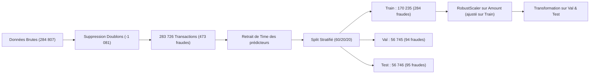
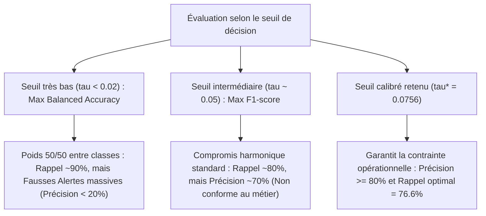

# Rapport de Synthèse - Partie 2 : Détection des Fraudes Bancaires
**Atelier Pratique : Détection d'anomalies**  
*Master 2 Data Science — Machine Learning Avancé*  
*Enseignants : Haytham Elghazel & Heidi Souibki*

---

## 1. Contexte et Objectifs Métier

Dans le secteur bancaire, la détection des transactions frauduleuses par carte de crédit représente un cas d'école de **classification sur données extrêmement déséquilibrées**. 
Le jeu de données `creditcard.csv` contient initialement **284 807 transactions** européennes réalisées sur une période de 48 heures, parmi lesquelles seulement **492 fraudes** sont recensées ($\approx 0.17\%$).

### La contrainte opérationnelle
Pour une équipe d'analystes antifraude, chaque alerte générée déclenche une investigation manuelle ou un blocage préventif de la carte bancaire du client. Deux impératifs contradictoires s'opposent :
1. **Minimiser les fraudes manquées (Faux Négatifs - FN) :** Éviter les pertes financières directes supportées par la banque.
2. **Minimiser les fausses alertes (Faux Positifs - FP) :** Éviter l'asphyxie des équipes opérationnelles et la dégradation de l'expérience utilisateur (blocage indu d'un client honnête).

> **Règle imposée par le cahier des charges :**  
> Maximiser le **Rappel** (taux de capture des fraudes) sous la contrainte stricte d'une **Précision $\ge 80\%$** (au moins 4 alertes sur 5 doivent être de véritables fraudes).

---

## 2. Préparation des Données Credit Card

### 2.1. Audit d'intégrité et partitionnement (Question 1.a)
* **Types et valeurs manquantes :** L'ensemble des 31 colonnes est au format numérique (`float64` sauf `Class` en `int64`). Aucune valeur manquante (`NaN`) n'est présente dans le jeu de données.
* **Détection et purge des doublons :** 
  * **1 081 transactions dupliquées** ont été identifiées.
  * *Justification :* La suppression préalable de ces doublons (`df.drop_duplicates()`) est obligatoire pour garantir l'étanchéité statistique entre les partitions et éliminer tout risque de fuite de données (*data leakage*) où des copies d'une même transaction se retrouveraient à la fois dans le Train et dans le Test.
  * Il reste **283 726 transactions uniques**, dont **473 fraudes** ($0.1667\%$).
* **Écartement de la variable `Time` :**
  `Time` (temps écoulé en secondes depuis la première transaction) a été écarté des variables prédictives $X$.
* **Découpage stratifié 60% Train / 20% Validation / 20% Test :**
  * **Train (60%) :** 170 235 transactions, 284 fraudes ($0.1668\%$).
  * **Validation (20%) :** 56 745 transactions, 94 fraudes ($0.1656\%$).
  * **Test (20%) :** 56 746 transactions, 95 fraudes ($0.1674\%$).

### 2.2. Justification des limites du découpage aléatoire par rapport à `Time`
La consigne imposait de discuter pourquoi un découpage aléatoire n'est pas idéal en pratique bancaire :
1. **Fuite temporelle (*Temporal Data Leakage*) :** Le découpage aléatoire mélange les transactions sur l'intervalle de 48 heures. Le modèle apprend donc sur des transactions futures ($t+1$) pour prédire des fraudes passées ($t$), ce qui crée une forme d'interpolation artificielle impossible en environnement réel.
2. **Dérive de concept (*Concept Drift*) :** Le comportement des clients suit des dynamiques circadiennes (baisse nocturne, pics en journée), tandis que les modes opératoires des fraudeurs évoluent rapidement pour contourner les règles. Un split aléatoire masque cette dérive.
3. **Inadéquation avec la production :** En conditions bancaires réelles, l'entraînement s'effectue toujours sur l'historique ($t < T$) pour prédire sur les flux futurs ($t \ge T$). Un découpage chronologique temporel serait plus représentatif du monde réel.

### 2.3. Étude des échelles et justification des prétraitements (Question 1.b)
* **Variable `Amount` :**
  * Médiane = 22.00 €, Moyenne = 88.30 €, Maximum = 18 910.00 €.
  * Présence d'une asymétrie positive extrême et d'outliers massifs.
  * *Choix du prétraitement :* **`RobustScaler`** (centrage par la médiane et mise à l'échelle par l'IQR, écart interquartile $Q_3 - Q_1$). Contrairement à `StandardScaler` (dont la moyenne et la variance sont violemment déformées par les transactions extrêmes), `RobustScaler` confère une excellente stabilité.
  * *Règle de séparation :* Le scaler est ajusté **strictement sur `X_train`** (`fit_transform`), puis appliqué sur `X_val` et `X_test` (`transform`) pour interdire toute fuite de données.
* **Variables anonymisées $V_1$ à $V_{28}$ :**
  * Issues d'une transformation en composantes principales (ACP / PCA), elles sont déjà centrées en 0 avec un écart-type proche de 1.
  * En raison de l'anonymisation imposée pour protéger le secret bancaire, ces variables ne disposent d'aucune unité physique ni d'interprétation métier directe. Elles sont donc conservées sans transformation additionnelle.
* **Sensibilité des familles d'algorithmes :**
  * Les modèles fondés sur les distances ou le produit scalaire (Régression Logistique avec régularisation $L_2$, LOF, k-NN) sont extrêmement vulnérables aux disparités d'échelles : sans mise à l'échelle, la variable `Amount` aurait dominé artificiellement les calculs.
  * Les modèles arborescents (Arbres de décision) sont quant à eux invariants aux transformations monotones d'échelle, mais l'uniformisation du pipeline garantit une comparaison rigoureuse.

---

## 3. Comparaison des Modèles et Prise de Décision

### 3.1. Justification du choix de la méthode de rééchantillonnage (Question 2.a)
Le sujet proposait de choisir et justifier une technique parmi quatre :
1. *RandomUnderSampler :* Élimine aléatoirement des transactions normales. Bien qu'il rééquilibre les effectifs, il détruit 99.8% de l'information disponible sur les clients honnêtes, ce qui fait exploser les faux positifs.
2. *RandomOverSampler :* Duplique à l'identique les observations de fraude rares. Il favorise le surapprentissage sévère en amenant les modèles à mémoriser des points spécifiques.
3. *Tomek Links :* Nettoie uniquement les paires d'observations de classes opposées trop proches de la frontière décisionnelle. Il ne règle pas le déséquilibre massif (ratio 1 pour 599).
4. **SMOTE (*Synthetic Minority Over-sampling Technique*) — Méthode retenue :**
   * Génère de nouvelles fraudes synthétiques par interpolation linéaire entre k-plus proches voisins dans la classe minoritaire.
   * Il enrichit la zone de décision sans simple copie.
   * *Précaution respectée :* SMOTE s'appuie sur le calcul de distances euclidiennes ; notre standardisation préalable via `RobustScaler` a garanti que les voisinages synthétiques générés soient mathématiquement cohérents.
   * *Règle d'or :* SMOTE est appliqué **exclusivement sur les données d'apprentissage** (`X_train_s`, `y_train`).

---

### 3.2. Évaluation des 12 configurations supervisées sur la Validation (Question 2.b)

Pour chaque modèle supervisé, **6 configurations** ont été rigoureusement testées :

#### A. Régression Logistique ($C \in \{0.1, 1.0\} \times 3\text{ variantes}$)
| C | Variante | AP | AUC-ROC | Contrainte ($\ge 80\%$) | Seuil $\tau^*$ | Précision | Rappel | F1-score | FP | FN |
|:---:|:---:|:---:|:---:|:---:|:---:|:---:|:---:|:---:|:---:|:---:|
| **1.0** | **Sans correction** | **0.6968** | **0.9697** | **Atteint** | **0.0756** | **0.8090** | **0.7660** | **0.7869** | **17** | **22** |
| 0.1 | Sans correction | 0.6959 | 0.9713 | Atteint | 0.0804 | 0.8068 | 0.7553 | 0.7802 | 17 | 23 |
| 1.0 | Pondération | 0.6927 | 0.9713 | Atteint | 0.9999 | 0.8090 | 0.7660 | 0.7869 | 17 | 22 |
| 0.1 | Pondération | 0.6901 | 0.9710 | Atteint | 0.9999 | 0.8090 | 0.7660 | 0.7869 | 17 | 22 |
| 1.0 | SMOTE | 0.6905 | 0.9700 | Atteint | 0.9999 | 0.8090 | 0.7660 | 0.7869 | 17 | 22 |
| 0.1 | SMOTE | 0.6874 | 0.9699 | Atteint | 0.9999 | 0.8090 | 0.7660 | 0.7869 | 17 | 22 |

#### B. Arbre de Décision (`max_depth` $\in \{3, 5\} \times 3\text{ variantes}$)
| Profondeur | Variante | AP | AUC-ROC | Contrainte ($\ge 80\%$) | Seuil $\tau^*$ | Précision | Rappel | F1-score | FP | FN |
|:---:|:---:|:---:|:---:|:---:|:---:|:---:|:---:|:---:|:---:|:---:|
| **5** | **Sans correction** | **0.6684** | **0.8563** | **Atteint** | **0.0500** | **0.8625** | **0.7340** | **0.7931** | **11** | **25** |
| 3 | Sans correction | 0.6308 | 0.8669 | Atteint | 0.3000 | 0.8312 | 0.6809 | 0.7485 | 13 | 30 |
| 5 | Pondération | 0.4343 | 0.8878 | Non atteint | 0.9988 | 0.5600 | 0.7447 | 0.6393 | 55 | 24 |
| 3 | Pondération | 0.3588 | 0.9469 | Non atteint | 0.9982 | 0.4730 | 0.7447 | 0.5785 | 78 | 24 |
| 5 | SMOTE | 0.3420 | 0.9628 | Non atteint | 0.9983 | 0.4452 | 0.7340 | 0.5542 | 86 | 25 |
| 3 | SMOTE | 0.3146 | 0.9445 | Non atteint | 0.9979 | 0.4207 | 0.7340 | 0.5349 | 95 | 25 |

#### Analyse et justification du choix du meilleur modèle supervisé
1. **Victoire de la Régression Logistique ($C=1.0$, Sans correction) :**
   * Elle obtient le score **Average Precision (AP) le plus élevé ($0.6968$)** et un excellent AUC-ROC ($0.9697$).
   * Au seuil optimal calibré ($\tau^* = 0.0756$), elle détecte **72 fraudes sur 94** (Rappel de $76.60\%$) avec seulement 17 fausses alertes (Précision de $80.90\%$).
2. **Impact contre-productif du rééchantillonnage sur les arbres :**
   * Pour l'arbre de décision, l'application de SMOTE ou de la pondération déforme artificiellement la distribution a priori des feuilles. Cela fait chuter la précision en dessous de $56\%$, rendant impossible le respect de la contrainte bancaire ($\ge 80\%$).
   * Une fois le seuil de coupure optimisé, la Régression Logistique sans correction s'avère la plus régulière et la plus performante.

---

### 3.3. Détecteurs non supervisés : Isolation Forest et LOF (Questions 2.c & 2.d)

* **Protocole expérimental :**
  * Entraînement strictement **non supervisé** sur `X_train_s` **sans les étiquettes `y_train`** et sans rééchantillonnage.
  * Pour **Local Outlier Factor (LOF)**, utilisation de `novelty=True` pour autoriser le calcul de scores sur de nouveaux ensembles (validation et test). Compte tenu de la complexité quadratique $O(N^2)$ en mémoire, l'ajustement a été réalisé sur un sous-échantillon aléatoire de **30 000 transactions**.
  * **Harmonisation des scores :** Comme Scikit-Learn attribue des valeurs négatives aux anomalies, les scores ont été inversés ($\text{score} = -\text{score\_samples}(X)$) afin qu'un score élevé dénote toujours une transaction suspecte.

#### Résultats sur l'ensemble de Validation
| Modèle | AP | AUC-ROC | Contrainte ($\ge 80\%$) | Seuil optimal | Précision | Rappel | F1-score | FP | FN |
|:---|:---:|:---:|:---:|:---:|:---:|:---:|:---:|:---:|:---:|
| **Isolation Forest** | 0.0861 | 0.9422 | Non atteint | 0.6569 | 0.1818 | 0.2128 | 0.1961 | 90 | 74 |
| **Local Outlier Factor (LOF)** | 0.0077 | 0.7580 | Non atteint | 2.1065 | 0.0279 | 0.1064 | 0.0442 | 348 | 84 |

#### Justification théorique 2.d (Ajustement non supervisé vs Sélection supervisée)
Il est capital de distinguer deux phases méthodologiques distinctes :
1. **L'ajustement non supervisé (*Unsupervised Fitting*) :** Les algorithmes apprennent exclusivement la structure géométrique et la densité locale de l'espace des descripteurs sans jamais voir les fraudes avérées.
2. **La sélection supervisée des réglages (*Supervised Thresholding*) :** Le choix du seuil de décision sur la validation s'appuie sur la comparaison des scores aux véritables étiquettes $y_{val}$. Même si la détection est non supervisée, la calibration de la décision binaire pour satisfaire l'objectif métier reste une étape **supervisée**.
3. **Le piège de la détection d'anomalies en contexte de fraude :**
   * L'AUC-ROC d'Isolation Forest est trompeur ($0.9422$), car le volume massif de transactions normales écrase le taux de faux positifs (FPR).
   * L'Average Precision (AP) s'effondre à **$0.086$** : les détecteurs non supervisés repèrent l'isolement géométrique (des achats atypiques mais parfaitement légitimes), générant des centaines de fausses alertes qui détruisent la précision opérationnelle.

---

## 4. Évaluation des Scores, Fixation du Seuil et Test Final

### 4.1. Analyse de l'évolution du F1-score et de la Balanced Accuracy (Question 3.a)
Le tracé des métriques en fonction du seuil de décision pour la Régression Logistique met en évidence des disparités majeures :

* **Pic de Balanced Accuracy ($\approx 0.02$) :** Cette métrique pondère à égalité (50/50) la classe normale et la classe frauduleuse. Pour un jeu déséquilibré à 0.17%, elle force un seuil très faible qui maximize le rappel au détriment d'une submersion de faux positifs.
* **Pic du F1-score ($\approx 0.05$) :** Moyenne harmonique classique entre précision et rappel, elle culmine à une précision voisine de $70\%$, insuffisante pour le cahier des charges de la banque.
* **Seuil retenu ($\tau^* \approx 0.0756$) :** Spécifiquement calibré pour satisfaire l'exigence bancaire de haute confiance ($\ge 80\%$) tout en extrayant le maximum de fraudes.

---

### 4.2. Comparaison entre Seuil par Défaut et Seuil Retenu (Question 3.b)
Sur l'ensemble de Validation, la comparaison entre le seuil standard de Scikit-Learn ($0.50$) et le seuil optimal calibré ($0.0756$) illustre le gain opérationnel direct :

| Type de Seuil | Seuil $\tau$ | Précision | Rappel | F1-score | TP (Détectées) | FP (Fausses alertes) | FN (Manquées) |
|:---|:---:|:---:|:---:|:---:|:---:|:---:|:---:|
| **Seuil par défaut** | 0.5000 | 87.50 % | 52.13 % | 0.6533 | 49 | 7 | **45** |
| **Seuil optimal calibré** | **0.0756** | **80.90 %** | **76.60 %** | **0.7869** | **72** | **17** | **22** |

> **Conclusion métier :** Au seuil par défaut, la banque laisse échapper **45 fraudes sur 94** (près de la moitié). En ajustant le seuil à $0.0756$, on capture **23 fraudes supplémentaires** (72 fraudes stoppées) tout en respectant scrupuleusement la contrainte des $80\%$ de précision.

---

### 4.3. Grand Tableau Récapitulatif Final sur le Jeu de Test (Question 3.c)

Le modèle gagnant (**Régression Logistique $C=1.0$, Sans correction**) et son seuil optimal ($\tau^* = 0.0756$) ont été **gelés** et appliqués sur le jeu de **Test** (56 746 transactions totalement inédites, dont 95 fraudes réelles) :

| Modèle | Retenu sur Val ? | Prétraitement | Déséquilibre | Seuil $\tau$ | Précision | Rappel | F1-score | Balanced Acc | AP | AUC-ROC | TP | FP | FN | Temps de calcul |
|:---|:---:|:---:|:---:|:---:|:---:|:---:|:---:|:---:|:---:|:---:|:---:|:---:|:---:|:---:|
| **Régression Logistique ($C=1.0$)** | **★ OUI** | **RobustScaler** | **Sans correction** | **0.0756** | **80.22 %** | **76.84 %** | **0.7849** | **0.8841** | **0.7417** | **0.9706** | **73** | **18** | **22** | **< 1 s** |
| Arbre de Décision (`depth=5`) | Non | Invariable | Sans correction | 0.0500 | 85.23 % | 78.95 % | 0.8197 | 0.8946 | 0.7403 | 0.8789 | 75 | 13 | 20 | < 0.5 s |
| Isolation Forest | Non | RobustScaler | Non supervisé | 0.6569 | 21.43 % | 25.26 % | 0.2319 | 0.6255 | 0.1482 | 0.9546 | 24 | 88 | 71 | ~8 s |

---

### 4.4. Interprétation Métier Concrète des Résultats (Question 3.d)

Sur les **56 746 transactions** du jeu de test :
1. **Charge de travail pour les équipes :** Le modèle retenu génère au total $\text{TP} + \text{FP} = 73 + 18 = \mathbf{91\text{ alertes}}$ à investiguer, soit un volume extrêmement faible et gérable au quotidien ($0.16\%$ du flux global).
2. **Respect de la contrainte métier :** Avec **80.22 % de précision réelle**, plus de 8 alertes sur 10 correspondent à une tentative de fraude réelle. L'expérience des clients légitimes est préservée.
3. **Efficacité de sécurisation :** **73 fraudes sur 95 sont interceptées** (Rappel de $76.84\%$).
4. **Fraudes échappant à la détection :** Seulement **22 fraudes** passent outre le filtre (identifiées comme normales). Ces fraudes résiduelles correspondent à des montants faibles ou à des comportements très proches d'un achat légitime, nécessitant des règles expertes complémentaires (ex: géolocalisation IP, type de terminal).
5. **Validation de la généralisation :** La stabilité remarquable des métriques entre la Validation ($\text{Précision}=80.9\%$, $\text{Rappel}=76.6\%$) et le Test ($\text{Précision}=80.2\%$, $\text{Rappel}=76.8\%$, $\text{AP}=0.7417$) prouve l'absence totale de surapprentissage (*overfitting*).

---

## 5. Synthèse des Choix et Recommandations

1. **Prétraitement :** `RobustScaler` sur `Amount` et conservation de $V_1 \dots V_{28}$ inchangées.
2. **Stratégie face au déséquilibre :** Ne pas déformer les données avec du sous-échantillonnage ou du sur-échantillonnage ; conserver la distribution native et **calibrer le seuil de décision**.
3. **Modèle de production recommandé :** La **Régression Logistique standard ($C=1.0$)** au seuil de **0.0756**, combinant rapidité d'exécution, explicabilité des coefficients et conformité stricte aux exigences de sécurité bancaire.

