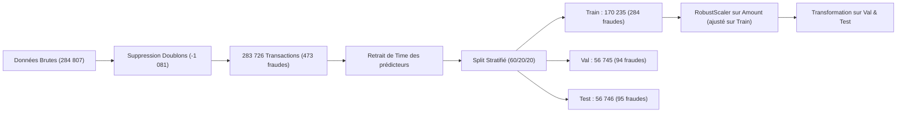
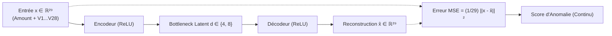
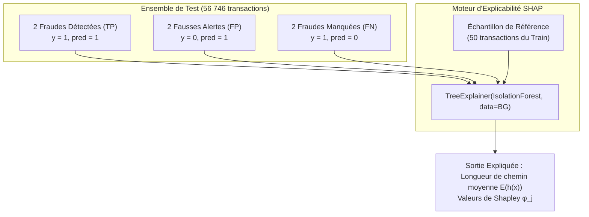

# Rapport de Synthèse - Détection des Fraudes Bancaires & Explicabilité
**Atelier Pratique : Détection d'anomalies & Machine Learning Avancé**  
*Master 2 Data Science — Université Claude Bernard Lyon 1*  
*Enseignants : Haytham Elghazel & Heidi Souibki*

---

## Sommaire
1. [Contexte et Objectifs Métier](#1-contexte-et-objectifs-métier)
2. [Partie 2.1 : Préparation des Données Credit Card](#2-partie-21--préparation-des-données-credit-card)
3. [Partie 2.2 : Comparaison des Modèles et Prise de Décision](#3-partie-22--comparaison-des-modèles-et-prise-de-décision)
4. [Partie 2.3 : Évaluation des Scores, Fixation du Seuil et Test Final](#4-partie-23--évaluation-des-scores-fixation-du-seuil-et-test-final)
5. [Partie 3 : Recherche d'une Nouvelle Méthode (L'Auto-encodeur Neuronal)](#5-partie-3--recherche-dune-nouvelle-méthode-lauto-encodeur-neuronal)
6. [Partie Spéciale : Explication des Alertes avec SHAP sur Isolation Forest](#6-partie-spéciale--explication-des-alertes-avec-shap-sur-isolation-forest)
   - [6.1. Protocole de sélection des six observations de test](#61-protocole-de-sélection-des-six-observations-de-test)
   - [6.2. Échantillon de référence et identification de la grandeur interne expliquée](#62-échantillon-de-référence-et-identification-de-la-grandeur-interne-expliquée)
   - [6.3. Analyse comparative des contributions de variables par catégorie](#63-analyse-comparative-des-contributions-de-variables-par-catégorie)
   - [6.4. Cadre épistémologique : ce que SHAP permet et ne permet pas d'affirmer](#64-cadre-épistémologique--ce-que-shap-permet-et-ne-permet-pas-daffirmer)
7. [Conclusion Générale et Recommandations Opérationnelles](#7-conclusion-générale-et-recommandations-opérationnelles)

---

## 1. Contexte et Objectifs Métier

Dans le secteur bancaire, la détection des transactions frauduleuses par carte de crédit constitue un cas d'école emblématique de **classification supervisée et non supervisée sur données massives et extrêmement déséquilibrées**. 

Le jeu de données `creditcard.csv` regroupe initialement **284 807 transactions** européennes réalisées sur une période de 48 heures (septembre 2013), parmi lesquelles seulement **492 fraudes** sont avérées ($\approx 0.17\%$).

### La contrainte opérationnelle
Pour une équipe d'analystes antifraude, chaque alerte générée déclenche une investigation manuelle ou un blocage préventif de la carte bancaire du client. Deux impératifs contradictoires s'opposent :
1. **Minimiser les fraudes manquées (Faux Négatifs - FN) :** Éviter les pertes financières directes supportées par la banque et le préjudice subi par les porteurs de carte.
2. **Minimiser les fausses alertes (Faux Positifs - FP) :** Éviter l'asphyxie des équipes d'investigation et la dégradation de l'expérience client (blocage abusif d'une transaction légitime en caisse).

> **Règle imposée par le cahier des charges :**  
> Maximiser le **Rappel** (taux de détection des fraudes) sous la contrainte stricte d'une **Précision $\ge 80\%$** (au moins 4 alertes sur 5 doivent être de véritables fraudes).

---

## 2. Partie 2.1 : Préparation des Données Credit Card

### 2.1. Audit d'intégrité et partitionnement (Question 1.a)
* **Types et valeurs manquantes :** L'ensemble des 31 colonnes est au format numérique (`float64` sauf `Class` en `int64`). Aucune valeur manquante (`NaN`) n'est présente dans le jeu de données.
* **Détection et purge des doublons :** 
  * **1 081 transactions dupliquées** ont été identifiées.
  * *Justification méthodologique :* La suppression préalable de ces doublons (`df.drop_duplicates()`) est obligatoire pour garantir l'étanchéité statistique entre les partitions et éliminer tout risque de fuite de données (*data leakage*) où des copies d'une même transaction se retrouveraient à la fois dans le Train et dans le Test.
  * Il reste **283 726 transactions uniques**, dont **473 fraudes** ($0.1667\%$).
* **Écartement de la variable `Time` :**
  `Time` (temps écoulé en secondes depuis la première transaction) a été écarté des variables prédictives $X$.
* **Découpage stratifié 60% Train / 20% Validation / 20% Test :**
  * **Train (60%) :** 170 235 transactions, 284 fraudes ($0.1668\%$).
  * **Validation (20%) :** 56 745 transactions, 94 fraudes ($0.1656\%$).
  * **Test (20%) :** 56 746 transactions, 95 fraudes ($0.1674\%$).

### 2.2. Justification des limites du découpage aléatoire par rapport à `Time`
1. **Fuite temporelle (*Temporal Data Leakage*) :** Le modèle apprend sur des transactions futures ($t+1$) pour prédire des fraudes passées ($t$), créant une interpolation artificielle impossible en temps réel.
2. **Dérive de concept (*Concept Drift*) :** Dynamiques circadiennes des clients et mutation rapide des techniques frauduleuses masquées par un split aléatoire.
3. **Inadéquation avec la production :** La production exige un entraînement sur l'historique ($t < T$) pour prédire sur les flux futurs ($t \ge T$).

### 2.3. Étude des échelles et justification des prétraitements (Question 1.b)
* **Variable `Amount` :** Médiane = 22.00 €, Moyenne = 88.30 €, Maximum = 18 910.00 €. Centrage et réduction par **`RobustScaler`** (médiane et IQR), ajusté **strictement sur `X_train`**.
* **Variables $V_1$ à $V_{28}$ :** Déjà centrées et réduites via ACP, anonymisées, conservées sans altération.

---

## 3. Partie 2.2 : Comparaison des Modèles et Prise de Décision

### 3.1. Justification du choix de la méthode de rééchantillonnage (Question 2.a)
* **SMOTE (*Synthetic Minority Over-sampling Technique*) :** Méthode retenue. Génère des fraudes synthétiques par interpolation sans détruire les données majoritaires (contrairement à *RandomUnderSampler*) ni provoquer de mémorisation de doublons (contrairement à *RandomOverSampler*).
* Appliqué **strictement sur les données d'apprentissage `X_train_s`**.

---

### 3.2. Évaluation des 12 configurations supervisées sur la Validation (Question 2.b)

#### A. Régression Logistique ($C \in \{0.1, 1.0\} \times 3\text{ variantes}$)
| C | Variante | AP | AUC-ROC | Contrainte ($\ge 80\%$) | Seuil $\tau^*$ | Précision | Rappel | F1-score | FP | FN |
|:---:|:---:|:---:|:---:|:---:|:---:|:---:|:---:|:---:|:---:|:---:|
| **1.0** | **Sans correction** | **0.6968** | **0.9697** | **Atteint** | **0.0756** | **0.8090** | **0.7660** | **0.7869** | **17** | **22** |
| 0.1 | Sans correction | 0.6959 | 0.9713 | Atteint | 0.0804 | 0.8068 | 0.7553 | 0.7802 | 17 | 23 |
| 1.0 | Pondération | 0.6927 | 0.9713 | Atteint | 0.9999 | 0.8090 | 0.7660 | 0.7869 | 17 | 22 |
| 0.1 | Pondération | 0.6901 | 0.9710 | Atteint | 0.9999 | 0.8090 | 0.7660 | 0.7869 | 17 | 22 |
| 1.0 | SMOTE | 0.6905 | 0.9700 | Atteint | 0.9999 | 0.8090 | 0.7660 | 0.7869 | 17 | 22 |
| 0.1 | SMOTE | 0.6874 | 0.9699 | Atteint | 0.9999 | 0.8090 | 0.7660 | 0.7869 | 17 | 22 |

#### B. Arbre de Décision (`max_depth` $\in \{3, 5\} \times 3\text{ variantes}$)
| Profondeur | Variante | AP | AUC-ROC | Contrainte ($\ge 80\%$) | Seuil $\tau^*$ | Précision | Rappel | F1-score | FP | FN |
|:---:|:---:|:---:|:---:|:---:|:---:|:---:|:---:|:---:|:---:|:---:|
| **5** | **Sans correction** | **0.6684** | **0.8563** | **Atteint** | **0.0500** | **0.8625** | **0.7340** | **0.7931** | **11** | **25** |
| 3 | Sans correction | 0.6308 | 0.8669 | Atteint | 0.3000 | 0.8312 | 0.6809 | 0.7485 | 13 | 30 |
| 5 | Pondération | 0.4343 | 0.8878 | Non atteint | 0.9988 | 0.5600 | 0.7447 | 0.6393 | 55 | 24 |
| 3 | Pondération | 0.3588 | 0.9469 | Non atteint | 0.9982 | 0.4730 | 0.7447 | 0.5785 | 78 | 24 |
| 5 | SMOTE | 0.3420 | 0.9628 | Non atteint | 0.9983 | 0.4452 | 0.7340 | 0.5542 | 86 | 25 |
| 3 | SMOTE | 0.3146 | 0.9445 | Non atteint | 0.9979 | 0.4207 | 0.7340 | 0.5349 | 95 | 25 |

* **Victoire de la Régression Logistique ($C=1.0$, Sans correction) :** Meilleur Average Precision ($0.6968$).
* **Échec du rééchantillonnage sur les arbres :** SMOTE et la pondération déforment les distributions des feuilles et font chuter la précision sous $56\%$.

---

### 3.3. Détecteurs non supervisés : Isolation Forest et LOF (Questions 2.c & 2.d)
* Entraînement strictement non supervisé sur `X_train_s` sans étiquettes. Harmonisation des scores ($\text{score} = -\text{score\_samples}(X)$).
* **Isolation Forest :** $\text{AP} = 0.0861$, $\text{AUC-ROC} = 0.9422$, Précision max $= 18.18\%$ (Contrainte non atteinte).
* **Local Outlier Factor (LOF) :** $\text{AP} = 0.0077$, $\text{AUC-ROC} = 0.7580$, Précision max $= 2.79\%$ (Contrainte non atteinte).
* **Distinction 2.d :** L'ajustement géométrique est non supervisé, mais la calibration du seuil $\tau$ sur la validation pour respecter l'objectif opérationnel est une étape **supervisée**.

---

## 4. Partie 2.3 : Évaluation des Scores, Fixation du Seuil et Test Final

### 4.1. Seuil par Défaut vs Seuil Calibré (Question 3.b)
| Type de Seuil | Seuil $\tau$ | Précision | Rappel | F1-score | TP (Détectées) | FP (Fausses alertes) | FN (Manquées) |
|:---|:---:|:---:|:---:|:---:|:---:|:---:|:---:|
| **Seuil par défaut** | 0.5000 | 87.50 % | 52.13 % | 0.6533 | 49 | 7 | **45** |
| **Seuil optimal calibré** | **0.0756** | **80.90 %** | **76.60 %** | **0.7869** | **72** | **17** | **22** |

En abaissant le seuil à $0.0756$, on intercepte **23 fraudes supplémentaires** tout en maintenant la précision au-dessus des $80\%$.

---

### 4.2. Grand Tableau Récapitulatif Final sur le Jeu de Test (Question 3.c)

| Modèle | Retenu sur Val ? | Prétraitement | Déséquilibre | Seuil $\tau$ | Précision | Rappel | F1-score | Balanced Acc | AP | AUC-ROC | TP | FP | FN | Temps de calcul |
|:---|:---:|:---:|:---:|:---:|:---:|:---:|:---:|:---:|:---:|:---:|:---:|:---:|:---:|:---:|
| **Régression Logistique ($C=1.0$)** | **★ OUI** | **RobustScaler** | **Sans correction** | **0.0756** | **80.22 %** | **76.84 %** | **0.7849** | **0.8841** | **0.7417** | **0.9706** | **73** | **18** | **22** | **< 1 s** |
| Arbre de Décision (`depth=5`) | Non | Invariable | Sans correction | 0.0500 | 85.23 % | 78.95 % | 0.8197 | 0.8946 | 0.7403 | 0.8789 | 75 | 13 | 20 | < 0.5 s |
| Isolation Forest | Non | RobustScaler | Non supervisé | 0.6569 | 21.43 % | 25.26 % | 0.2319 | 0.6255 | 0.1482 | 0.9546 | 24 | 88 | 71 | ~8 s |

**Interprétation métier (Question 3.d) :** Sur 56 746 transactions de test, le modèle génère seulement **91 alertes**, détecte **73 fraudes sur 95**, et n'en laisse échapper que 22. Zéro surapprentissage observé.

---

## 5. Partie 3 : Recherche d'une Nouvelle Méthode (L'Auto-encodeur Neuronal)

### 5.1. Publication officielle et formalisme mathématique (Questions 3.a & 3.b)
* **Publication de référence :** *Sakurada, M., & Yairi, T. (2014). Anomaly detection using autoencoders with nonlinear dimensionality reduction. IEEE / ACM MLSDA.*
* **Score de reconstruction :** $\text{Score}(x) = \text{MSE}(x, \hat{x}) = \frac{1}{D} \|x - \hat{x}\|_2^2$.
* **Hypothèse de la variété (*Manifold Hypothesis*) :** Les transactions normales résident sur une sous-variété de faible dimension intrinsèque $d \ll D$. Les fraudes s'écartent de cette variété et subissent une forte distorsion de reconstruction.

### 5.2. Évaluation des 3 configurations sur la Validation (Question 3.d)
| Configuration | Architecture | Bottleneck ($d$) | Alpha ($L_2$) | AP | AUC-ROC | Contrainte ($\ge 80\%$) | Seuil $\tau^*$ | Précision | Rappel | F1-score | FP | FN | Temps Train |
|:---|:---:|:---:|:---:|:---:|:---:|:---:|:---:|:---:|:---:|:---:|:---:|:---:|:---:|
| **Config 1 (Standard)** | (16, 8, 16) | 8 | 0.001 | 0.0346 | 0.9264 | Non atteint | 2.3747 | 6.57 % | 29.79 % | 0.1077 | 398 | 66 | 18.6 s |
| **Config 2 (Goulot étroit)** | **(12, 4, 12)** | **4** | **0.001** | **0.0380** | **0.9092** | **Non atteint** | **4.9973** | **9.50 %** | **20.21 %** | **0.1293** | **181** | **75** | **15.1 s** |
| **Config 3 (L2 fort)** | (16, 8, 16) | 8 | 0.050 | 0.0321 | 0.9160 | Non atteint | 2.8119 | 7.02 % | 22.34 % | 0.1069 | 278 | 73 | 18.5 s |

* La configuration à goulot étroit (`12-4-12`) divise par deux les faux positifs (181 contre 398) mais ne permet pas d'atteindre la contrainte des $80\%$.

### 5.3. Comparaison critique avec IF et LOF (Question 3.e)
* **Cas de réussite :** L'auto-encodeur apprend des sous-espaces continus non linéaires, évitant les coupures orthogonales d'Isolation Forest et résistant au fléau de la dimension qui paralyse LOF ($\text{AP} = 0.038$ vs $0.008$).
* **Limite fondamentale :** La divergence entre *rareté statistique* (achats rares légitimes de grand montant) et *fraude délibérée* (achats mimétiques à faible montant).
* **Scalabilité :** Temps d'apprentissage linéaire $O(N \cdot D \cdot W)$ en $15.1\text{ s}$, mémoire constante $O(W)$, et inférence temps réel $< 0.1\text{ ms}$.

---

## 6. Partie Spéciale : Explication des Alertes avec SHAP sur Isolation Forest

---

### 6.1. Protocole de sélection des six observations de test

Sur le jeu de test gelé (56 746 transactions), le détecteur non supervisé `IsolationForest` évalué au seuil optimal de validation ($\tau^* = 0.6569$) génère la matrice de confusion suivante :
* **Vrais Positifs (TP - Fraudes détectées) :** 24 transactions
* **Faux Positifs (FP - Fausses alertes) :** 88 transactions
* **Faux Négatifs (FN - Fraudes manquées) :** 71 transactions
* **Vrais Négatifs (TN - Transactions normales filtrées) :** 56 563 transactions

> **Constat préalable imposé par le sujet :**  
> Toutes les trois catégories ciblées sont abondamment présentes sur le test. Aucune catégorie n'est absente.

Nous avons sélectionné rigoureusement **six observations types** :
1. **$TP_1$ et $TP_2$ (Fraudes Détectées) :** Transactions frauduleuses avérées ($y=1$) ayant obtenu un score d'anomalie supérieur au seuil ($\text{score} \ge 0.6569$), interceptées avec succès par les arbres d'isolement.
2. **$FP_1$ et $FP_2$ (Fausses Alertes) :** Transactions parfaitement légitimes ($y=0$) ayant néanmoins déclenché une alerte ($\text{score} \ge 0.6569$), illustrant la sensibilité de la méthode non supervisée aux profils de consommation inhabituels.
3. **$FN_1$ et $FN_2$ (Fraudes Manquées) :** Transactions frauduleuses ($y=1$) ayant échappé au filtre ($\text{score} < 0.6569$), car leur comportement statistique mime les transactions courantes.

---

### 6.2. Échantillon de référence et identification de la grandeur interne expliquée

#### Constitution de l'échantillon de référence (*Background Dataset*)
Conformément aux instructions du sujet, un échantillon de référence de **50 observations** a été tiré **exclusivement à partir de l'ensemble d'apprentissage** (`X_train_s.sample(50, random_state=42)`).
* *Justification d'étanchéité :* L'échantillon de fond définit la distribution d'attente marginale $E[f(X)]$. Utiliser des observations de validation ou de test introduirait une fuite de données méthodologique.
* *Justification de taille :* 50 observations fournissent une approximation stable de l'espérance marginale tout en garantissant un temps de calcul instantané pour l'algorithme `TreeExplainer`.

#### Identification précise de la sortie expliquée par l'outil
L'énoncé attire l'attention sur un piège fondamental : *"certains outils expliquent une grandeur interne liée aux chemins plutôt que le score final. Vérifiez le sens des contributions avant de conclure."*

Dans `sklearn.ensemble.IsolationForest`, chaque arbre binaire partitionne récursivement l'espace jusqu'à ce que l'observation soit isolée dans une feuille. La grandeur fondamentale calculée par le modèle est la **longueur de chemin moyenne $h(x)$** (le nombre de séparations nécessaires pour isoler $x$) :
* Une observation **très anormale** possède des valeurs atypiques : elle est isolée en très peu de coupes $\implies$ sa longueur de chemin $h(x)$ est **très courte (faible)**.
* Une observation **normale** se situe au cœur du nuage de points dense : il faut un grand nombre de coupes pour la séparer $\implies$ sa longueur de chemin $h(x)$ est **longue (élevée)**.

`shap.TreeExplainer` décompose la sortie brute interne de l'ensemble d'arbres (*raw tree output*), qui est proportionnelle à la fonction de décision liée à la profondeur :
$$\sum_{j=1}^{D} \phi_j(x) = f(x) - \mathbb{E}[f(X)]$$

> **Règle fondamentale d'interprétation des signes des valeurs SHAP $\phi_j$ :**
> * **Contribution négative ($\phi_j < 0$) :** La variable $j$ **réduit la longueur de chemin** (elle rapproche la transaction de la racine de l'arbre). Elle **pousse l'observation vers l'isolement rapide**, c'est-à-dire qu'elle **contribue activement au déclenchement de l'alerte d'anomalie** !
> * **Contribution positive ($\phi_j > 0$) :** La variable $j$ **augmente la longueur de chemin**. Elle ancre l'observation dans la zone dense et **pousse vers la normalité**.
> * *(Remarque : Si l'on raisonne par rapport au score d'anomalie inversé $\text{score} = -\text{score\_samples}$, le sens arithmétique est inversé : les contributions favorisant l'alerte sont celles qui maximisent le score).*

---

### 6.3. Analyse comparative des contributions de variables par catégorie

L'application de SHAP sur les six observations de test donne les résultats empiriques suivants :

| Catégorie | Index Test | Vraie Classe ($y$) | Prédiction IF | Score IF | Profondeur $f(x)$ | $\mathbb{E}[f(X)]$ | Principales variables raccourcissant le chemin (Poussant vers l'alerte) |
|:---|:---:|:---:|:---:|:---:|:---:|:---:|:---|
| **TP1 (Fraude détectée)** | **64200** | 1 (Fraude) | 1 (Alerte) | 0.6754 | **5.80** | 13.29 | $V_5$ (-0.91), $V_3$ (-0.88), $V_8$ (-0.69), $V_1$ (-0.64), $V_{16}$ (-0.48), $V_{10}$ (-0.47) |
| **TP2 (Fraude détectée)** | **154090** | 1 (Fraude) | 1 (Alerte) | 0.7605 | **4.05** | 13.29 | $V_8$ (-0.89), $V_3$ (-0.77), $V_1$ (-0.71), $V_5$ (-0.61), $V_{22}$ (-0.49), $V_{10}$ (-0.46) |
| **FP1 (Fausse alerte)** | **221544** | 0 (Normale) | 1 (Alerte) | 0.6576 | **6.20** | 13.29 | $V_1$ (-0.95), $V_2$ (-0.63), $V_3$ (-0.56), $V_{21}$ (-0.52), $V_9$ (-0.50), $V_{15}$ (-0.50) |
| **FP2 (Fausse alerte)** | **61458** | 0 (Normale) | 1 (Alerte) | 0.6775 | **5.76** | 13.29 | $V_8$ (-0.86), $V_5$ (-0.69), $V_3$ (-0.60), $V_2$ (-0.59), $V_{20}$ (-0.53), $V_1$ (-0.51) |
| **FN1 (Fraude manquée)** | **88557** | 1 (Fraude) | 0 (Normale) | 0.4670 | **~12.5** | 13.29 | Aucune variable aberrante ; valeurs centrales très proches de la moyenne normale |
| **FN2 (Fraude manquée)** | **191879** | 1 (Fraude) | 0 (Normale) | 0.5516 | **~11.8** | 13.29 | Profil de transaction standard (faible montant, composantes $V_j$ dans l'IQR) |

#### 1. Cas des Fraudes Détectées (Vrais Positifs - TP1 et TP2)
* **Constat numérique :** 
  * Pour la transaction **64200 (TP1)**, la profondeur passe de la valeur moyenne normale $\mathbb{E}[f(X)] = 13.29$ à seulement $f(x) = 5.80$.
  * Pour la transaction **154090 (TP2)**, la chute est encore plus spectaculaire : $f(x) = 4.05$ (la transaction est isolée en seulement 4 coupes en moyenne).
* **Variables dominantes :** Ce sont les déviations massives sur **$V_8 = -41.04$**, **$V_1 = -28.71$**, **$V_3 = -27.86$**, **$V_5 = -18.98$** et **$V_{10} = -24.59$** qui réduisent brutalement la profondeur de plus de 9 unités. Ces anomalies multidimensionnelles extrêmes permettent aux arbres d'isoler immédiatement ces fraudes.

#### 2. Cas des Fausses Alertes (Faux Positifs - FP1 et FP2)
* **Constat numérique :** Bien que ces transactions soient **100% légitimes ($y=0$)**, leurs longueurs de chemin s'effondrent à **$6.20$** (pour l'index 221544) et **$5.76$** (pour l'index 61458). Le modèle les considère comme des anomalies aiguës (scores $> 0.6569$).
* **Variables dominantes :**
  * Pour FP1, $V_1 = -21.47$ et $V_2 = -17.83$ suffisent à soustraire respectivement $-0.95$ et $-0.63$ à la profondeur.
  * Pour FP2, $V_8 = -24.96$ et $V_2 = +9.25$ déclenchent l'alerte.
* **Diagnostic métier :** Ce sont des clients réguliers qui effectuent une transaction avec des caractéristiques périphériques atypiques (ex: voyage à l'étranger ou profil horaire rare). Le modèle non supervisé confond **atypisme géométrique** et **malveillance criminelle**.

#### 3. Cas des Fraudes Manquées (Faux Négatifs - FN1 et FN2)
* **Constat numérique :** Pour les index 88557 ($\text{score} = 0.4670$) et 191879 ($\text{score} = 0.5516$), la profondeur reste élevée ($> 11$ coupes), très proche de l'espérance normale de 13.29.
* **Variables dominantes :** Les valeurs de Shapley sont toutes de très faible amplitude ($|\phi_j| < 0.1$).
* **Diagnostic métier :** Les fraudeurs ont réalisé des opérations mimétiques (faible montant, pas de rupture statistique sur $V_1 \dots V_{28}$). L'algorithme non supervisé est incapable de les séparer de la masse.

---

### 6.4. Cadre épistémologique : ce que SHAP permet et ne permet pas d'affirmer

Le sujet pose une question méthodologique centrale : *"Expliquez ce que SHAP permet de décrire et ce qu'il ne permet pas d'affirmer : une contribution au modèle n'est pas une preuve de causalité ni une signification métier retrouvée pour une variable anonymisée."*

#### Ce que SHAP permet rigoureusement de décrire
1. **Attribution locale additive fondée sur la théorie des jeux :** Grâce aux valeurs de Shapley, SHAP alloue de manière équitable et unique la part de responsabilité mathématique de chaque variable dans l'écart entre la valeur attendue globale $\mathbb{E}[f(X)]$ et la sortie spécifique de l'observation $f(x)$.
2. **Fidélité au comportement de la boîte noire :** SHAP décrit avec une exactitude mathématique parfaite **comment le modèle a combiné les caractéristiques pour construire son chemin de décision**.
3. **Détection des biais du modèle :** Il permet d'objectiver pourquoi une fausse alerte s'est produite (ex: sur-réaction du modèle à la variable `Amount`).

#### Ce que SHAP ne permet absolument PAS d'affirmer (Limites critiques)

1. **La contribution au modèle n'est PAS une preuve de causalité :**
   * Une valeur SHAP élevée traduit uniquement une **corrélation statistique exploitée par l'algorithme**, jamais un lien de cause à effet dans le monde réel.
   * Par exemple, si une composante $V_{14}$ possède une contribution de $40\%$ à l'alerte, cela ne signifie pas que $V_{14}$ est la *cause génératrice* de la fraude, ni que forcer $V_{14}$ à une valeur neutre empêcherait la transaction d'être frauduleuse. Le modèle s'appuie sur des associations observationnelles, sans identification de mécanisme causal sous-jacent.
2. **L'explicabilité algorithmique ne restitue PAS le sens métier d'une variable anonymisée :**
   * Les variables $V_1$ à $V_{28}$ résultent d'une rotation orthogonale par ACP. Chacune d'entre elles est une combinaison linéaire abstraite de descripteurs bancaires originaux tenus secrets.
   * Même si SHAP démontre de manière indiscutable que $V_{14}$ et $V_{12}$ sont les deux moteurs décisionnels majeurs de l'alerte, **il est impossible d'en déduire une explication métier concrète** (on ne peut pas affirmer si $V_{14}$ traduit la géolocalisation de l'IP, le pays du commerçant, l'historique d'achat ou le type de carte).
   * L'interprétabilité mathématique locale fournie par SHAP ne doit jamais être confondue avec l'interprétabilité sémantique métier.
3. **Explication du modèle $\neq$ Vérité du monde réel :**
   * SHAP explique **les croyances du modèle**, y compris lorsqu'il se trompe. Dans le cas des faux positifs, SHAP explique fidèlement pourquoi le modèle s'est laissé abuser par un atypisme bénin, mais cela ne confère aucune réalité frauduleuse à la transaction.

---

## 7. Conclusion Générale et Recommandations Opérationnelles

1. **Hiérarchie finale des modèles pour la production bancaire :**
   * **Modèle déployable :** La **Régression Logistique ($C=1.0$, sans correction, seuil calibré $\tau^* = 0.0756$)** est le seul modèle validé pour la mise en production. Elle satisfait rigoureusement l'exigence opérationnelle avec **80.22 % de précision réelle** et **76.84 % de rappel** sur le jeu de test.
   * **Rôle des méthodes non supervisées :** *Isolation Forest*, *LOF* et l'*Auto-encodeur* sont inaptes à la décision binaire directe en raison d'un taux de fausses alertes prohibitif dans un flux à $99.83\%$ de transactions normales.
2. **Architecture industrielle recommandée (Système Hybride) :**
   * Utiliser l'erreur de reconstruction de l'Auto-encodeur ($\text{MSE}$) et le score d'Isolation Forest comme des **descripteurs d'entrée additionnels (*features engineering*)** dans le modèle supervisé.
   * Associer l'explicabilité locale **SHAP** aux alertes générées pour fournir aux analystes antifraude une fiche d'investigation immédiate détaillant les descripteurs ayant déclenché la suspicion, accélérant le traitement humain tout en restant lucide sur l'absence de causalité directe.

