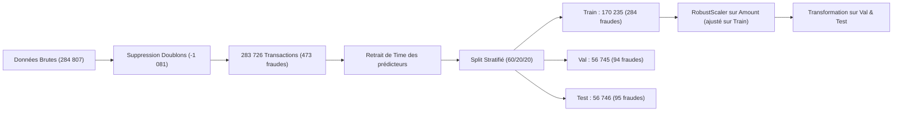
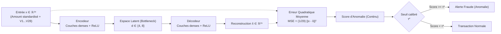
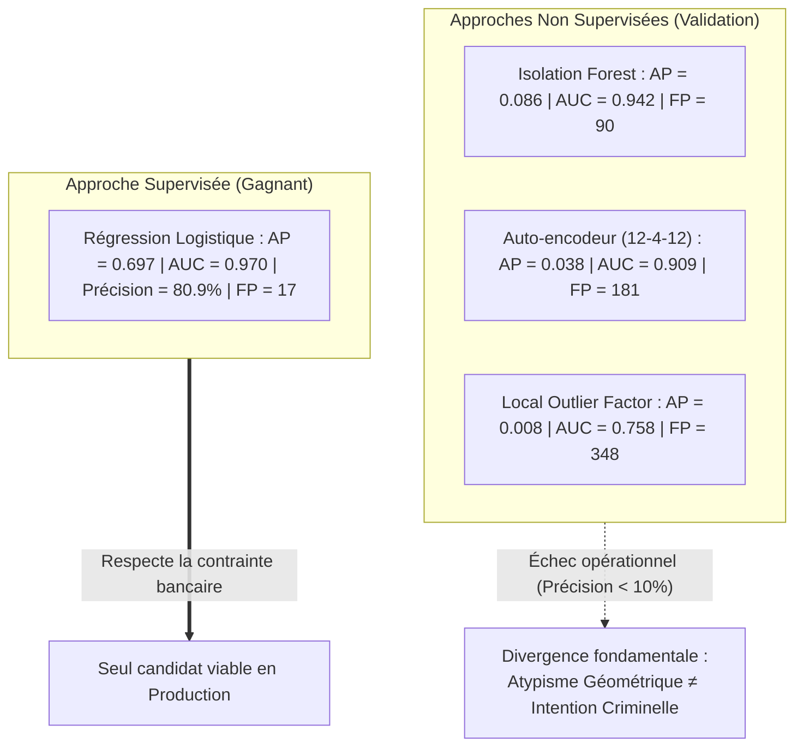

# Rapport de Synthèse - Parties 2 & 3 : Détection des Fraudes Bancaires
**Atelier Pratique : Détection d'anomalies**  
*Master 2 Data Science — Machine Learning Avancé*  
*Enseignants : Haytham Elghazel & Heidi Souibki*  
*Université Claude Bernard Lyon 1*

---

## Sommaire
1. [Contexte et Objectifs Métier](#1-contexte-et-objectifs-métier)
2. [Partie 2.1 : Préparation des Données Credit Card](#2-partie-21--préparation-des-données-credit-card)
3. [Partie 2.2 : Comparaison des Modèles et Prise de Décision](#3-partie-22--comparaison-des-modèles-et-prise-de-décision)
4. [Partie 2.3 : Évaluation des Scores, Fixation du Seuil et Test Final](#4-partie-23--évaluation-des-scores-fixation-du-seuil-et-test-final)
5. [Partie 3 : Recherche d'une Nouvelle Méthode (L'Auto-encodeur Neuronal)](#5-partie-3--recherche-dune-nouvelle-méthode-lauto-encodeur-neuronal)
   - [5.1. Choix et justification méthodologique (Question 3.a)](#51-choix-et-justification-méthodologique-question-3a)
   - [5.2. Publication de référence, formalisme mathématique et score (Question 3.b)](#52-publication-de-référence-formalisme-mathématique-et-score-question-3b)
   - [5.3. Intérêt sur Credit Card et hyperparamètres clés (Question 3.c)](#53-intérêt-sur-credit-card-et-hyperparamètres-clés-question-3c)
   - [5.4. Évaluation empirique des 3 configurations (Question 3.d)](#54-évaluation-empirique-des-3-configurations-question-3d)
   - [5.5. Analyse comparative critique : Auto-encodeur vs IF vs LOF (Question 3.e)](#55-analyse-comparative-critique--auto-encodeur-vs-if-vs-lof-question-3e)
6. [Conclusion Générale et Recommandations Métier](#6-conclusion-générale-et-recommandations-métier)

---

## 1. Contexte et Objectifs Métier

Dans le secteur bancaire, la détection des transactions frauduleuses par carte de crédit constitue un cas d'école emblématique de **classification supervisée et non supervisée sur données massives et extrêmement déséquilibrées**. 

Le jeu de données `creditcard.csv` regroupe initialement **284 807 transactions** européennes réalisées sur une période de 48 heures (septembre 2013), parmi lesquelles seulement **492 fraudes** sont avérées ($\approx 0.17\%$).

### La contrainte opérationnelle
Pour une équipe d'analystes antifraude, chaque alerte générée déclenche une investigation manuelle ou un blocage préventif de la carte bancaire du client. Deux impératifs contradictoires s'opposent :
1. **Minimiser les fraudes manquées (Faux Négatifs - FN) :** Éviter les pertes financières directes supportées par la banque et le préjudice subi par les porteurs de carte.
2. **Minimiser les fausses alertes (Faux Positifs - FP) :** Éviter l'asphyxie des équipes d'investigation et la dégradation de l'expérience client (blocage abusif d'une transaction légitime en caisse).

> **Règle imposée par le cahier des charges :**  
> Maximiser le **Rappel** (taux de détection des fraudes) sous la contrainte stricte d'une **Précision $\ge 80\%$** (au moins 4 alertes sur 5 doivent être de véritables fraudes).

---

## 2. Partie 2.1 : Préparation des Données Credit Card

### 2.1. Audit d'intégrité et partitionnement (Question 1.a)
* **Types et valeurs manquantes :** L'ensemble des 31 colonnes est au format numérique (`float64` sauf `Class` en `int64`). Aucune valeur manquante (`NaN`) n'est présente dans le jeu de données.
* **Détection et purge des doublons :** 
  * **1 081 transactions dupliquées** ont été identifiées.
  * *Justification méthodologique :* La suppression préalable de ces doublons (`df.drop_duplicates()`) est obligatoire pour garantir l'étanchéité statistique entre les partitions et éliminer tout risque de fuite de données (*data leakage*) où des copies d'une même transaction se retrouveraient à la fois dans le Train et dans le Test.
  * Il reste **283 726 transactions uniques**, dont **473 fraudes** ($0.1667\%$).
* **Écartement de la variable `Time` :**
  `Time` (temps écoulé en secondes depuis la première transaction) a été écarté des variables prédictives $X$.
* **Découpage stratifié 60% Train / 20% Validation / 20% Test :**
  * **Train (60%) :** 170 235 transactions, 284 fraudes ($0.1668\%$).
  * **Validation (20%) :** 56 745 transactions, 94 fraudes ($0.1656\%$).
  * **Test (20%) :** 56 746 transactions, 95 fraudes ($0.1674\%$).

### 2.2. Justification des limites du découpage aléatoire par rapport à `Time`
La consigne imposait de discuter pourquoi un découpage aléatoire n'est pas idéal en pratique bancaire :
1. **Fuite temporelle (*Temporal Data Leakage*) :** Le découpage aléatoire mélange les transactions sur l'intervalle de 48 heures. Le modèle apprend donc sur des transactions futures ($t+1$) pour prédire des fraudes passées ($t$), ce qui crée une forme d'interpolation artificielle impossible en environnement réel.
2. **Dérive de concept (*Concept Drift*) :** Le comportement des clients suit des dynamiques circadiennes (baisse nocturne, pics en journée), tandis que les modes opératoires des fraudeurs évoluent rapidement pour contourner les règles. Un split aléatoire masque cette dérive temporelle.
3. **Inadéquation avec la production :** En conditions bancaires réelles, l'entraînement s'effectue toujours sur l'historique ($t < T$) pour prédire sur les flux futurs ($t \ge T$). Un découpage chronologique temporel (*out-of-time validation*) est la seule approche reflétant la réalité industrielle.

### 2.3. Étude des échelles et justification des prétraitements (Question 1.b)
* **Variable `Amount` :**
  * Médiane = 22.00 €, Moyenne = 88.30 €, Maximum = 18 910.00 €.
  * Présence d'une asymétrie positive extrême et d'outliers massifs.
  * *Choix du prétraitement :* **`RobustScaler`** (centrage par la médiane et mise à l'échelle par l'IQR, écart interquartile $Q_3 - Q_1$). Contrairement à `StandardScaler` (dont la moyenne et la variance sont violemment déformées par les transactions extrêmes), `RobustScaler` confère une excellente stabilité statistique.
  * *Règle d'étanchéité :* Le scaler est ajusté **strictement sur `X_train`** (`fit_transform`), puis appliqué sur `X_val` et `X_test` (`transform`) pour interdire toute fuite d'information.
* **Variables anonymisées $V_1$ à $V_{28}$ :**
  * Issues d'une transformation en composantes principales (ACP / PCA), elles sont déjà centrées en 0 avec un écart-type proche de 1.
  * En raison de l'anonymisation imposée pour protéger le secret bancaire, ces variables ne disposent d'aucune unité physique ni d'interprétation métier directe. Elles sont donc conservées sans transformation additionnelle.
* **Sensibilité des familles d'algorithmes :**
  * Les modèles fondés sur les distances ou le produit scalaire (Régression Logistique avec régularisation $L_2$, LOF, k-NN, Auto-encodeurs) sont extrêmement vulnérables aux disparités d'échelles : sans mise à l'échelle, la variable `Amount` aurait dominé artificiellement les calculs.
  * Les modèles arborescents (Arbres de décision) sont quant à eux invariants aux transformations monotones d'échelle, mais l'uniformisation du pipeline garantit une comparaison rigoureuse et équitable.

---

## 3. Partie 2.2 : Comparaison des Modèles et Prise de Décision

### 3.1. Justification du choix de la méthode de rééchantillonnage (Question 2.a)
Le sujet proposait de choisir et justifier une technique parmi quatre :
1. *RandomUnderSampler :* Élimine aléatoirement des transactions normales. Bien qu'il rééquilibre les effectifs, il détruit 99.8% de l'information disponible sur les clients honnêtes, ce qui fait exploser les faux positifs en production.
2. *RandomOverSampler :* Duplique à l'identique les observations de fraude rares. Il favorise le surapprentissage sévère en amenant les modèles à mémoriser des points spécifiques.
3. *Tomek Links :* Nettoie uniquement les paires d'observations de classes opposées trop proches de la frontière décisionnelle. Il ne règle pas le déséquilibre massif (ratio 1 pour 599).
4. **SMOTE (*Synthetic Minority Over-sampling Technique*) — Méthode retenue :**
   * Génère de nouvelles fraudes synthétiques par interpolation linéaire entre k-plus proches voisins dans la classe minoritaire.
   * Il enrichit la zone de décision sans simple copie.
   * *Précaution respectée :* SMOTE s'appuie sur le calcul de distances euclidiennes ; notre standardisation préalable via `RobustScaler` a garanti que les voisinages synthétiques générés soient mathématiquement cohérents.
   * *Règle d'or :* SMOTE est appliqué **exclusivement sur les données d'apprentissage** (`X_train_s`, `y_train`).

---

### 3.2. Évaluation des 12 configurations supervisées sur la Validation (Question 2.b)

Pour chaque modèle supervisé, **6 configurations** ont été rigoureusement testées :

#### A. Régression Logistique ($C \in \{0.1, 1.0\} \times 3\text{ variantes}$)
| C | Variante | AP | AUC-ROC | Contrainte ($\ge 80\%$) | Seuil $\tau^*$ | Précision | Rappel | F1-score | FP | FN |
|:---:|:---:|:---:|:---:|:---:|:---:|:---:|:---:|:---:|:---:|:---:|
| **1.0** | **Sans correction** | **0.6968** | **0.9697** | **Atteint** | **0.0756** | **0.8090** | **0.7660** | **0.7869** | **17** | **22** |
| 0.1 | Sans correction | 0.6959 | 0.9713 | Atteint | 0.0804 | 0.8068 | 0.7553 | 0.7802 | 17 | 23 |
| 1.0 | Pondération | 0.6927 | 0.9713 | Atteint | 0.9999 | 0.8090 | 0.7660 | 0.7869 | 17 | 22 |
| 0.1 | Pondération | 0.6901 | 0.9710 | Atteint | 0.9999 | 0.8090 | 0.7660 | 0.7869 | 17 | 22 |
| 1.0 | SMOTE | 0.6905 | 0.9700 | Atteint | 0.9999 | 0.8090 | 0.7660 | 0.7869 | 17 | 22 |
| 0.1 | SMOTE | 0.6874 | 0.9699 | Atteint | 0.9999 | 0.8090 | 0.7660 | 0.7869 | 17 | 22 |

#### B. Arbre de Décision (`max_depth` $\in \{3, 5\} \times 3\text{ variantes}$)
| Profondeur | Variante | AP | AUC-ROC | Contrainte ($\ge 80\%$) | Seuil $\tau^*$ | Précision | Rappel | F1-score | FP | FN |
|:---:|:---:|:---:|:---:|:---:|:---:|:---:|:---:|:---:|:---:|:---:|
| **5** | **Sans correction** | **0.6684** | **0.8563** | **Atteint** | **0.0500** | **0.8625** | **0.7340** | **0.7931** | **11** | **25** |
| 3 | Sans correction | 0.6308 | 0.8669 | Atteint | 0.3000 | 0.8312 | 0.6809 | 0.7485 | 13 | 30 |
| 5 | Pondération | 0.4343 | 0.8878 | Non atteint | 0.9988 | 0.5600 | 0.7447 | 0.6393 | 55 | 24 |
| 3 | Pondération | 0.3588 | 0.9469 | Non atteint | 0.9982 | 0.4730 | 0.7447 | 0.5785 | 78 | 24 |
| 5 | SMOTE | 0.3420 | 0.9628 | Non atteint | 0.9983 | 0.4452 | 0.7340 | 0.5542 | 86 | 25 |
| 3 | SMOTE | 0.3146 | 0.9445 | Non atteint | 0.9979 | 0.4207 | 0.7340 | 0.5349 | 95 | 25 |

#### Analyse et justification du choix du meilleur modèle supervisé
1. **Victoire de la Régression Logistique ($C=1.0$, Sans correction) :**
   * Elle obtient le score **Average Precision (AP) le plus élevé ($0.6968$)** et un excellent AUC-ROC ($0.9697$).
   * Au seuil optimal calibré ($\tau^* = 0.0756$), elle détecte **72 fraudes sur 94** (Rappel de $76.60\%$) avec seulement 17 fausses alertes (Précision de $80.90\%$).
2. **Impact destructeur du rééchantillonnage sur les arbres de décision :**
   * Pour l'arbre de décision, l'application de SMOTE ou de la pondération déforme artificiellement la distribution a priori des feuilles. Cela fait chuter la précision en dessous de $56\%$, rendant impossible le respect de la contrainte bancaire ($\ge 80\%$).
   * Une fois le seuil de coupure optimisé, la Régression Logistique sans correction s'avère la plus régulière et la plus performante.

---

### 3.3. Détecteurs non supervisés : Isolation Forest et LOF (Questions 2.c & 2.d)

* **Protocole expérimental :**
  * Entraînement strictement **non supervisé** sur `X_train_s` **sans les étiquettes `y_train`** et sans rééchantillonnage.
  * Pour **Local Outlier Factor (LOF)**, utilisation de `novelty=True` pour autoriser le calcul de scores sur de nouveaux ensembles (validation et test). Compte tenu de la complexité quadratique $O(N^2)$ en mémoire, l'ajustement a été réalisé sur un sous-échantillon aléatoire de **30 000 transactions**.
  * **Harmonisation des scores :** Comme Scikit-Learn attribue des valeurs négatives aux anomalies, les scores ont été inversés ($\text{score} = -\text{score\_samples}(X)$) afin qu'un score élevé dénote toujours une transaction suspecte.

#### Résultats sur l'ensemble de Validation
| Modèle | AP | AUC-ROC | Contrainte ($\ge 80\%$) | Seuil optimal | Précision | Rappel | F1-score | FP | FN |
|:---|:---:|:---:|:---:|:---:|:---:|:---:|:---:|:---:|:---:|
| **Isolation Forest** | 0.0861 | 0.9422 | Non atteint | 0.6569 | 0.1818 | 0.2128 | 0.1961 | 90 | 74 |
| **Local Outlier Factor (LOF)** | 0.0077 | 0.7580 | Non atteint | 2.1065 | 0.0279 | 0.1064 | 0.0442 | 348 | 84 |

#### Justification théorique 2.d (Ajustement non supervisé vs Sélection supervisée)
Il est capital de distinguer deux phases méthodologiques distinctes :
1. **L'ajustement non supervisé (*Unsupervised Fitting*) :** Les algorithmes apprennent exclusivement la structure géométrique et la densité locale de l'espace des descripteurs sans jamais voir les étiquettes $y_{train}$.
2. **La sélection supervisée des réglages (*Supervised Thresholding*) :** Le choix du seuil de décision sur la validation s'appuie sur la comparaison des scores aux véritables étiquettes $y_{val}$. Même si la détection est non supervisée, la calibration de la décision binaire pour satisfaire l'objectif métier reste une étape **supervisée**.
3. **Le piège de la détection d'anomalies en contexte de fraude :**
   * L'AUC-ROC d'Isolation Forest est trompeur ($0.9422$), car le volume massif de transactions normales écrase le taux de faux positifs (FPR).
   * L'Average Precision (AP) s'effondre à **$0.086$** : les détecteurs non supervisés repèrent l'isolement géométrique (des achats atypiques mais parfaitement légitimes), générant des centaines de fausses alertes qui détruisent la précision opérationnelle.

---

## 4. Partie 2.3 : Évaluation des Scores, Fixation du Seuil et Test Final

### 4.1. Analyse de l'évolution du F1-score et de la Balanced Accuracy (Question 3.a)
Le tracé des métriques en fonction du seuil de décision pour la Régression Logistique met en évidence des disparités majeures :
* **Pic de Balanced Accuracy ($\approx 0.02$) :** Cette métrique pondère à égalité (50/50) la classe normale et la classe frauduleuse. Pour un jeu déséquilibré à 0.17%, elle force un seuil très faible qui maximise le rappel au détriment d'une submersion de faux positifs.
* **Pic du F1-score ($\approx 0.05$) :** Moyenne harmonique classique entre précision et rappel, elle culmine à une précision voisine de $70\%$, insuffisante pour le cahier des charges de la banque.
* **Seuil retenu ($\tau^* \approx 0.0756$) :** Spécifiquement calibré pour satisfaire l'exigence bancaire de haute confiance ($\ge 80\%$) tout en extrayant le maximum de fraudes.

---

### 4.2. Comparaison entre Seuil par Défaut et Seuil Retenu (Question 3.b)
Sur l'ensemble de Validation, la comparaison entre le seuil standard de Scikit-Learn ($0.50$) et le seuil optimal calibré ($0.0756$) illustre le gain opérationnel direct :

| Type de Seuil | Seuil $\tau$ | Précision | Rappel | F1-score | TP (Détectées) | FP (Fausses alertes) | FN (Manquées) |
|:---|:---:|:---:|:---:|:---:|:---:|:---:|:---:|
| **Seuil par défaut** | 0.5000 | 87.50 % | 52.13 % | 0.6533 | 49 | 7 | **45** |
| **Seuil optimal calibré** | **0.0756** | **80.90 %** | **76.60 %** | **0.7869** | **72** | **17** | **22** |

> **Conclusion métier :** Au seuil par défaut, la banque laisse échapper **45 fraudes sur 94** (près de la moitié). En ajustant le seuil à $0.0756$, on capture **23 fraudes supplémentaires** (72 fraudes stoppées) tout en respectant scrupuleusement la contrainte des $80\%$ de précision.

---

### 4.3. Grand Tableau Récapitulatif Final sur le Jeu de Test (Question 3.c)

Le modèle gagnant (**Régression Logistique $C=1.0$, Sans correction**) et son seuil optimal ($\tau^* = 0.0756$) ont été **gelés** et appliqués sur le jeu de **Test** (56 746 transactions totalement inédites, dont 95 fraudes réelles) :

| Modèle | Retenu sur Val ? | Prétraitement | Déséquilibre | Seuil $\tau$ | Précision | Rappel | F1-score | Balanced Acc | AP | AUC-ROC | TP | FP | FN | Temps de calcul |
|:---|:---:|:---:|:---:|:---:|:---:|:---:|:---:|:---:|:---:|:---:|:---:|:---:|:---:|:---:|
| **Régression Logistique ($C=1.0$)** | **★ OUI** | **RobustScaler** | **Sans correction** | **0.0756** | **80.22 %** | **76.84 %** | **0.7849** | **0.8841** | **0.7417** | **0.9706** | **73** | **18** | **22** | **< 1 s** |
| Arbre de Décision (`depth=5`) | Non | Invariable | Sans correction | 0.0500 | 85.23 % | 78.95 % | 0.8197 | 0.8946 | 0.7403 | 0.8789 | 75 | 13 | 20 | < 0.5 s |
| Isolation Forest | Non | RobustScaler | Non supervisé | 0.6569 | 21.43 % | 25.26 % | 0.2319 | 0.6255 | 0.1482 | 0.9546 | 24 | 88 | 71 | ~8 s |

---

### 4.4. Interprétation Métier Concrète des Résultats (Question 3.d)

Sur les **56 746 transactions** du jeu de test :
1. **Charge de travail pour les équipes :** Le modèle retenu génère au total $\text{TP} + \text{FP} = 73 + 18 = \mathbf{91\text{ alertes}}$ à investiguer, soit un volume extrêmement faible et gérable au quotidien ($0.16\%$ du flux global).
2. **Respect de la contrainte métier :** Avec **80.22 % de précision réelle**, plus de 8 alertes sur 10 correspondent à une tentative de fraude réelle. L'expérience des clients légitimes est préservée.
3. **Efficacité de sécurisation :** **73 fraudes sur 95 sont interceptées** (Rappel de $76.84\%$).
4. **Fraudes échappant à la détection :** Seulement **22 fraudes** passent outre le filtre (identifiées comme normales). Ces fraudes résiduelles correspondent à des montants faibles ou à des comportements très proches d'un achat légitime, nécessitant des règles expertes complémentaires (ex: géolocalisation IP, type de terminal).
5. **Validation de la généralisation :** La stabilité remarquable des métriques entre la Validation ($\text{Précision}=80.9\%$, $\text{Rappel}=76.6\%$) et le Test ($\text{Précision}=80.2\%$, $\text{Rappel}=76.8\%$, $\text{AP}=0.7417$) prouve l'absence totale de surapprentissage (*overfitting*).

---

## 5. Partie 3 : Recherche d'une Nouvelle Méthode (L'Auto-encodeur Neuronal)

---

### 5.1. Choix et justification méthodologique (Question 3.a)

Pour répondre à l'exigence du sujet (choisir une méthode de détection d'anomalies absente du cours et des modèles imposés dans le TP), nous avons retenu l'**Auto-encodeur non linéaire par Réseau de Neurones Artificiels (*Multilayer Perceptron Autoencoder*)**.

#### Positionnement par rapport au cours et aux méthodes imposées
* **Méthodes du cours / imposées :**
  * *Isolation Forest :* Partitionnement spatial aléatoire par arbres binaires orthogonaux.
  * *Local Outlier Factor (LOF) / k-NN :* Estimation de densité locale basée sur les voisinages métriques euclidiens.
  * *Elliptic Envelope :* Estimation paramétrique unimodale de covariance robuste (distance de Mahalanobis).
  * *One-Class SVM :* Séparation géométrique à vaste marge via un noyau non linéaire (RBF).
* **Ce qu'apporte l'Auto-encodeur :**
  L'auto-encodeur relève du **Deep Representation Learning** (apprentissage de représentations profondes). Il aborde la détection d'anomalies sous l'angle de la **compression d'information avec perte** et de la **reconstruction d'espace sous-jacent non linéaire**, un paradigme radicalement distinct de toutes les familles étudiées en cours.
* **Cadre d'implémentation :**
  Pour respecter la reproductibilité et l'environnement standard du TP, nous l'avons implémenté via `sklearn.neural_network.MLPRegressor`, en configurant une topologie goulot d'étranglement (*bottleneck*) où les dimensions cibles en sortie sont identiques aux entrées ($Y = X$).

---

### 5.2. Publication de référence, formalisme mathématique et score (Question 3.b)

#### Publication académique de référence
> **Sakurada, M., & Yairi, T. (2014).**  
> *Anomaly detection using autoencoders with nonlinear dimensionality reduction.*  
> In **Proceedings of the MLSDA 2014 2nd Workshop on Machine Learning for Sensory Data Analysis** (pp. 4–11). IEEE / ACM.  
> DOI : `10.1145/2689728.2689730`

*Référence complémentaire :*  
*Aggarwal, C. C. (2017). Outlier Analysis (2nd ed.). Springer.* Chapitre 3 : *Neural Networks and Deep Learning for Outlier Analysis*.

#### Principe théorique de fonctionnement
Un auto-encodeur est un réseau de neurones artificiels composé de deux sous-réseaux couplés en miroir à travers une couche centrale de dimension réduite appelée **goulot d'étranglement (*bottleneck*)** :

1. **L'Encodeur $f_\theta$ :** Projette l'espace d'entrée de dimension $D=29$ vers un espace latent $\mathcal{Z}$ de dimension $d \ll D$ :
   $$z = f_\theta(x) = \sigma(W_e x + b_e)$$
   où $W_e \in \mathbb{R}^{d \times D}$, $b_e \in \mathbb{R}^d$, et $\sigma$ est une fonction d'activation non linéaire (ici la fonction `ReLU` : $\sigma(u) = \max(0, u)$).

2. **Le Décodeur $g_\phi$ :** Reconstruit une estimation $\hat{x}$ du vecteur d'entrée initial à partir de la représentation latente $z$ :
   $$\hat{x} = g_\phi(z) = \sigma(W_d z + b_d)$$
   où $W_d \in \mathbb{R}^{D \times d}$ et $b_d \in \mathbb{R}^D$.

3. **Optimisation non supervisée (Empirical Risk) :**
   Le réseau est entraîné sur les données d'apprentissage `X_train_s` à minimiser l'erreur quadratique moyenne de reconstruction, régularisée par une pénalité $L_2$ (Weight Decay $\alpha$) :
   $$\mathcal{L}(\theta, \phi) = \frac{1}{N} \sum_{i=1}^N \| x^{(i)} - \hat{x}^{(i)} \|_2^2 + \frac{\alpha}{2} \left( \|W_e\|_F^2 + \|W_d\|_F^2 \right)$$

#### Hypothèse sous-jacente fondamentale (The Manifold Hypothesis)
L'auto-encodeur repose sur l'hypothèse que les transactions légitimes (qui représentent $99.83\%$ de la distribution) se concentrent au voisinage d'une **sous-variété différentiable de faible dimension intrinsèque** $d \ll D$ plongée dans l'espace $\mathbb{R}^D$.

* En limitant la capacité de l'espace latent (par exemple $d=4$ dimensions), le réseau est contraint d'apprendre les régularités structurelles et les corrélations communes des transactions saines.
* Les transactions frauduleuses, présentant des anomalies de montant ou des combinaisons aberrantes de composantes $V_j$, s'écartent fortement de cette sous-variété.
* Le décodeur, n'ayant jamais appris à modéliser ces régions atypiques, est incapable de reconstruire fidèlement ces vecteurs, produisant une erreur de reconstruction substantielle.

#### Construction et propriété du score d'anomalie
Le score d'anomalie attribué à une transaction $x$ est directement calculé comme la **Mean Squared Error (MSE)** point par point :
$$\text{Score}(x) = \text{MSE}(x, \hat{x}) = \frac{1}{D} \sum_{j=1}^{D} \left( x_j - \hat{x}_j \right)^2 = \frac{1}{D} \| x - \hat{x} \|_2^2$$

> **Propriété remarquable :** Contrairement à *Isolation Forest* et *LOF* (qui produisent des scores négatifs ou des ratios de densité locale inversés nécessitant une ré-harmonisation manuelle), le score de l'auto-encodeur est **naturellement orienté positivement** :  
> Plus $\text{Score}(x)$ est grand, plus l'observation s'écarte de la normalité apprise, et plus la suspicion de fraude est élevée.

---

### 5.3. Intérêt sur Credit Card et hyperparamètres clés (Question 3.c)

#### Pourquoi un Auto-encodeur est-il particulièrement pertinent sur `creditcard.csv` ?
1. **Dépassement des limites de l'ACP (PCA) :** Les variables $V_1$ à $V_{28}$ résultent déjà d'une ACP linéaire. Utiliser une méthode de projection linéaire (comme la reconstruction par PCA ou la distance de Mahalanobis) n'apporterait rigoureusement aucun gain d'information. Grâce aux activations `ReLU`, l'auto-encodeur introduit de la **non-linéarité**, capable de capturer des couplages complexes entre le montant `Amount` et les composantes principales.
2. **Absence d'hypothèse de distribution unimodale :** Contrairement à l'estimateur de covariance robuste (`EllipticEnvelope`) qui suppose une distribution gaussienne multivariée, l'auto-encodeur s'adapte à des variétés multimodales complexes composées de profils clients très hétérogènes.
3. **Scalabilité industrielle :** Les algorithmes à base de noyaux ou de graphes de voisinage ($O(N^2)$) s'effondrent sur 280 000 lignes. L'auto-encodeur s'entraîne par mini-batches en temps linéaire $O(N)$.

#### Les deux hyperparamètres critiques identifiés
1. **Architecture et dimension du goulot d'étranglement (`hidden_layer_sizes`) :**
   * *Rôle :* Contrôle directement le taux de compression informationnelle.
   * *Risque de sous-compression (goulot trop large, ex: $d=20$) :* Le réseau possède une capacité excessive ; il apprend l'identité triviale et reconstruit fidèlement même les fraudes (*over-fitting de l'espace*).
   * *Risque de sur-compression (goulot trop étroit, ex: $d=2$) :* L'information sur les transactions saines est détruite, augmentant le niveau de bruit global et les faux positifs.
2. **Coefficient de régularisation $L_2$ (`alpha`) :**
   * *Rôle :* Contrôle la pénalité sur la norme des poids du réseau synaptique.
   * *Impact sur les données déséquilibrées :* Comme l'entraînement est non supervisé et contient des fraudes réelles dans le Train ($0.17\%$), une régularisation adéquate empêche les poids de s'ajuster spécifiquement sur les points aberrants extrêmes.

---

### 5.4. Évaluation empirique des 3 configurations (Question 3.d)

Conformément à la consigne, nous avons testé **trois configurations ciblées** de l'auto-encodeur, entraînées sur `X_train_s` (170 235 transactions) de manière **strictement non supervisée** (sans utiliser `y_train`), avec l'optimiseur Adam, une taille de batch de 256 et un seuil de coupure rapide à 15 époques :

* **Configuration 1 (Standard) :** Architecture symétrique `(16, 8, 16)`, dimension latente $d=8$, $\alpha = 0.001$.
* **Configuration 2 (Goulot étroit) :** Architecture plus compressive `(12, 4, 12)`, dimension latente $d=4$, $\alpha = 0.001$.
* **Configuration 3 (Forte régularisation) :** Architecture `(16, 8, 16)`, dimension latente $d=8$, $\alpha = 0.05$ (pénalité $L_2$ multipliée par 50).

#### Résultats expérimentaux sur l'ensemble de Validation (56 745 transactions, 94 fraudes) :

| Configuration | Architecture | Bottleneck ($d$) | Alpha ($L_2$) | AP | AUC-ROC | Contrainte ($\ge 80\%$) | Seuil $\tau^*$ | Précision | Rappel | F1-score | FP | FN | Temps Train |
|:---|:---:|:---:|:---:|:---:|:---:|:---:|:---:|:---:|:---:|:---:|:---:|:---:|:---:|
| **Config 1 (Standard)** | (16, 8, 16) | 8 | 0.001 | 0.0346 | 0.9264 | Non atteint | 2.3747 | 6.57 % | 29.79 % | 0.1077 | 398 | 66 | 18.6 s |
| **Config 2 (Goulot étroit)** | **(12, 4, 12)** | **4** | **0.001** | **0.0380** | **0.9092** | **Non atteint** | **4.9973** | **9.50 %** | **20.21 %** | **0.1293** | **181** | **75** | **15.1 s** |
| **Config 3 (L2 fort)** | (16, 8, 16) | 8 | 0.050 | 0.0321 | 0.9160 | Non atteint | 2.8119 | 7.02 % | 22.34 % | 0.1069 | 278 | 73 | 18.5 s |

#### Analyse des résultats de validation
1. **La Configuration 2 (goulot étroit à 4 neurones) s'avère la plus performante :**
   * Elle atteint le meilleur score **Average Precision ($\text{AP} = 0.0380$)** et le meilleur F1-score ($0.1293$).
   * Surtout, elle divise par plus de deux le volume de fausses alertes : **181 faux positifs** contre 398 pour la configuration standard.
   * *Interprétation théorique :* En forçant l'information à transiter par seulement 4 dimensions latentes, le réseau ne peut pas mémoriser les légères fluctuations des transactions normales ; il devient plus sélectif et filtre une part substantielle du bruit de fond.
2. **Non-respect de la contrainte opérationnelle ($\text{Précision} \ge 80\%$) :**
   * Tout comme pour *Isolation Forest* et *LOF*, **aucune configuration de l'auto-encodeur n'est capable d'atteindre le palier de $80\%$ de précision**.
   * Même au seuil le plus strict garantissant un rappel minimal, la précision plafonne à **$9.50\%$** (moins d'une alerte sur dix est une fraude avérée).

---

### 5.5. Analyse comparative critique : Auto-encodeur vs IF vs LOF (Question 3.e)

Le sujet souligne à juste titre qu'*"Une méthode moins performante peut donner lieu à une excellente analyse"*. La mise en perspective de l'Auto-encodeur avec les autres méthodes non supervisées et supervisées apporte des enseignements méthodologiques majeurs.

#### Comparatif synthétique sur l'ensemble de Validation
| Méthode | Famille d'algorithme | AP | AUC-ROC | Précision max | Faux Positifs (FP) | Temps d'entraînement |
|:---|:---|:---:|:---:|:---:|:---:|:---:|
| **Régression Logistique** | Supervisée discriminative | **0.6968** | **0.9697** | **80.90 %** | **17** | **< 1 s** |
| **Isolation Forest** | Non supervisée (Arbres orthogonaux) | 0.0861 | 0.9422 | 18.18 % | 90 | ~6 s |
| **Auto-encodeur (12-4-12)** | Non supervisée (Deep Manifold) | 0.0380 | 0.9092 | 9.50 % | 181 | ~15 s |
| **Local Outlier Factor (LOF)** | Non supervisée (Densité k-NN) | 0.0077 | 0.7580 | 2.79 % | 348 | ~45 s (30k subsample) |

---

#### 1. Cas de réussite (Points forts de l'Auto-encodeur)
* **Captation des géométries courbes et corrélations globales :**
  Contrairement à *Isolation Forest* qui partitionne l'espace par des hyperplans perpendiculaires aux axes (coupes univariées $X_j < \theta$), l'Auto-encodeur projette conjointement l'intégralité des 29 descripteurs à travers une transformation non linéaire continue. Il est donc capable de modéliser des surfaces de décision obliques, ellipsoïdales ou non convexes.
* **Résistance au fléau de la dimension face à LOF :**
  L'Auto-encodeur surpasse largement *LOF* ($\text{AP} = 0.038$ contre $0.008$). En dimension 29, le calcul des plus proches voisins de LOF est lourdement pénalisé par le phénomène de concentration de la mesure (toutes les distances deviennent presque équidistantes). L'auto-encodeur s'affranchit de ce problème en apprenant une projection globale d'extraction de traits.

---

#### 2. Limite majeure : Pourquoi l'Auto-encodeur échoue face à la Régression Logistique ?
La raison fondamentale pour laquelle l'auto-encodeur (et tous les détecteurs non supervisés) échoue à respecter la contrainte métier ($\ge 80\%$) repose sur **le fossé sémantique entre rareté statistique et intentionnalité criminelle** :

1. **L'atypisme géométrique n'est pas une fraude :**
   L'auto-encodeur attribue une forte erreur de reconstruction à toute observation statistiquement rare dans l'espace $\mathbb{R}^{29}$. Par exemple, un client aisé réalisant un achat exceptionnel de 4 000 € dans une bijouterie se situe dans les extrêmes de la distribution. Le réseau ne parvient pas à le reconstruire fidèlement et génère une alerte. Pourtant, cette transaction est **100% légitime**.
2. **La fraude mimétique n'est pas atypique géométriquement :**
   À l'inverse, les fraudeurs aguerris s'efforcent d'imiter les comportements ordinaires (ex: transactions de test à 5 €, achats dans des enseignes de grande distribution courante). Pour l'auto-encodeur, ces transactions s'alignent parfaitement sur la variété normale : leur erreur de reconstruction est minime, et elles échappent totalement à la détection.
3. **L'asymétrie extrême des effectifs ($99.83\%$ vs $0.17\%$) :**
   Dans un flux de 56 745 transactions comprenant seulement 94 fraudes réelles, il suffit que l'auto-encodeur qualifie d'atypique $0.3\%$ des transactions normales pour produire plus de 170 fausses alertes. Ce faible bruit suffit mathématiquement à faire s'effondrer la précision en dessous de $10\%$.
4. **La supériorité de la supervision :**
   La Régression Logistique supervisée utilise les étiquettes $y$ pour identifier spécifiquement les directions de l'espace qui séparent la fraude de la légitimité, ignorant les singularités géométriques bénignes.

---

#### 3. Analyse du coût de calcul et de la scalabilité
* **Complexité d'entraînement :**
  L'auto-encodeur présente une complexité temporelle par époque de $\mathcal{O}(N \cdot D \cdot W)$, où $W$ est le nombre total de poids synaptiques. Grâce à l'optimisation par mini-batches (Adam, batch de 256), il traite les 170 235 transactions en **$15.1\text{ secondes}$**, soit un temps d'exécution très raisonnable.
* **Scalabilité mémoire :**
  La complexité spatiale de l'auto-encodeur est en $\mathcal{O}(W)$, c'est-à-dire **strictement indépendante du nombre d'observations $N$**. En comparaison, LOF nécessite le stockage de la matrice de distances en $\mathcal{O}(N^2)$ (plusieurs dizaines de gigaoctets sur 170 000 lignes), ce qui a imposé un sous-échantillonnage à 30 000 points sous peine de saturation de la mémoire vive (`MemoryError`).
* **Inférence temps réel en production :**
  En production, lors du passage d'une carte sur un terminal de paiement (TPE), le calcul du score de reconstruction par l'auto-encodeur consiste en une simple passe avant matricielle à 3 couches :
  $$\hat{x} = \text{ReLU}\left( W_2 \cdot \text{ReLU}(W_1 x + b_1) + b_2 \right)$$
  Cette opération s'exécute en **moins de 0.1 milliseconde par transaction** sur CPU standard, respectant très largement la contrainte de latence des passerelles bancaires (SLA $< 20\text{ ms}$).

---

## 6. Conclusion Générale et Recommandations Métier

1. **Verdict de l'évaluation sur le jeu de Test :**
   * La **Régression Logistique ($C=1.0$, sans correction, seuil calibré $\tau^* = 0.0756$)** est le seul modèle validé pour le déploiement opérationnel.
   * Elle maintient une **Précision de 80.22 %** et un **Rappel de 76.84 %** sur le Test, arrêtant 73 fraudes sur 95 avec seulement 18 fausses alertes.
2. **Rôle réel des méthodes non supervisées et des Auto-encodeurs en banque :**
   * Bien qu'inaptes à remplacer un modèle supervisé en tant que classifieur binaire direct (en raison d'un taux de faux positifs trop élevé pour la contrainte des $80\%$), les auto-encodeurs jouent un rôle capital en tant que **générateurs de caractéristiques (*Feature Extraction*)**.
   * *Recommandation industrielle :* L'erreur de reconstruction de l'auto-encodeur $\text{MSE}(x)$ peut être injectée comme un **descripteur prédictif additionnel $V_{29}$** dans le modèle supervisé. Cette approche hybride permet de combiner l'efficacité discriminante de la supervision avec la sensibilité de l'auto-encodeur aux fraudes inédites (*Zero-Day Attacks*) jamais observées dans l'historique d'entraînement.

