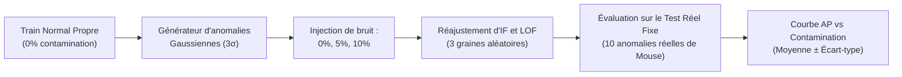
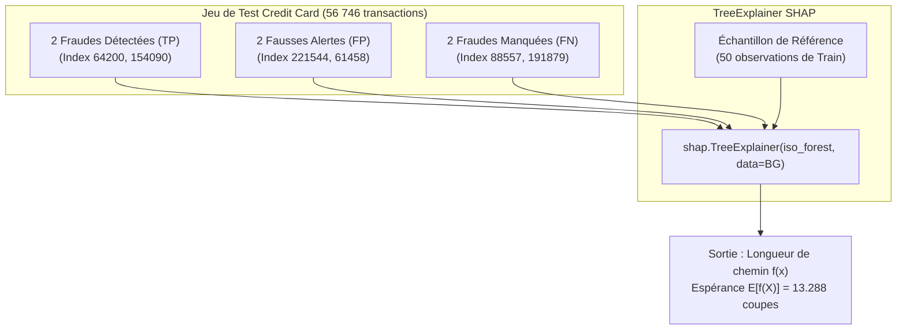

# Rapport de Synthèse - Partie 5 : Robustesse & Explicabilité
**Atelier Pratique : Détection d'anomalies & Machine Learning Avancé**  
*Master 2 Data Science — Université Claude Bernard Lyon 1*  
*Enseignants : Haytham Elghazel & Heidi Souibki*

---

## Sommaire
1. [Contexte et Objectifs de la Partie 5](#1-contexte-et-objectifs-de-la-partie-5)
2. [Partie 5.1 : Évaluation de la Robustesse à la Contamination (Jeu de données Mouse)](#2-partie-51--évaluation-de-la-robustesse-à-la-contamination-jeu-de-données-mouse)
   - [2.1. Protocole expérimental d'injection d'anomalies synthétiques](#21-protocole-expérimental-dinjection-danomalies-synthétiques)
   - [2.2. Résultats comparatifs : Average Precision vs Taux de contamination](#22-résultats-comparatifs--average-precision-vs-taux-de-contamination)
   - [2.3. Analyse de la sensibilité d'Isolation Forest et de Local Outlier Factor](#23-analyse-de-la-sensibilité-disolation-forest-et-de-local-outlier-factor)
3. [Partie 5.2 : Explication des Alertes avec SHAP sur Isolation Forest (Jeu de données Credit Card)](#3-partie-52--explication-des-alertes-avec-shap-sur-isolation-forest-jeu-de-données-credit-card)
   - [3.1. Protocole de sélection des six observations de test](#31-protocole-de-sélection-des-six-observations-de-test)
   - [3.2. Échantillon de référence et identification de la grandeur interne expliquée](#32-échantillon-de-référence-et-identification-de-la-grandeur-interne-expliquée)
   - [3.3. Analyse comparative des contributions locales par catégorie (TP, FP, FN)](#33-analyse-comparative-des-contributions-locales-par-catégorie-tp-fp-fn)
   - [3.4. Cadre épistémologique : ce que SHAP permet et ne permet pas d'affirmer](#34-cadre-épistémologique--ce-que-shap-permet-et-ne-permet-pas-daffirmer)
4. [Conclusion Générale de la Partie 5](#4-conclusion-générale-de-la-partie-5)

---

## 1. Contexte et Objectifs de la Partie 5

Un système de détection d'anomalies déployé en environnement réel doit répondre à deux exigences complémentaires indispensables :
1. **La Robustesse face aux données bruitées ou contaminées (Partie 5.1) :** Dans la pratique industrielle, la base d'apprentissage « normale » est rarement parfaitement pure. Elle contient souvent une fraction inconnue d'anomalies non étiquetées. Le modèle doit conserver son pouvoir discriminant malgré cette pollution.
2. **L'Explicabilité et la Transparence algorithmique (Partie 5.2) :** Une alerte déclenchée sans justification est inutilisable pour les équipes métiers (analystes de fraude bancaire). L'approche SHAP (*SHapley Additive exPlanations*) permet d'ouvrir la boîte noire des arbres d'isolement pour auditer chaque décision.

---

## 2. Partie 5.1 : Évaluation de la Robustesse à la Contamination (Jeu de données Mouse)

### 2.1. Protocole expérimental d'injection d'anomalies synthétiques

L'objectif est d'étudier comment l'apprentissage d'**Isolation Forest** et de **Local Outlier Factor (LOF)** résiste à une contamination progressive de l'ensemble d'entraînement sain :
* **Données de base :** Jeu synthétique 2D `mouse.txt` (composé de la tête et des deux oreilles de Mickey représentant les clusters normaux denses, et de points aberrants isolés).
* **Partitionnement strict (Novelty Detection) :** 
  * Le jeu d'entraînement propre ($0\%$ de contamination) ne contient que des observations normales (`y_train = 0`).
  * L'ensemble de test reste **strictement fixe et non contaminé** (il contient les transactions normales réservées et l'intégralité des anomalies réelles du jeu).
* **Méthode de contamination (`contaminate_train`) :**
  * Une fraction $r \in \{0\%, 5\%, 10\%\}$ des observations normales d'apprentissage est substituée par des anomalies artificielles générées autour du centroïde global avec une variance élargie ($3 \times \sigma$).
  * La taille du jeu d'entraînement demeure rigoureusement constante.
* **Reproductibilité :** Pour chaque taux, l'expérience est répétée sur **3 graines aléatoires** (`seeds = (42, 43, 44)`).

---

### 2.2. Résultats comparatifs : Average Precision vs Taux de contamination

Le tableau ci-dessous synthétise la moyenne et l'écart-type de l'**Average Precision (AP)** obtenus sur l'ensemble de test réel :

| Modèle | Taux de Contamination | AP Moyenne ($\mu$) | Écart-type ($\sigma$) | Comportement observé |
|:---|:---:|:---:|:---:|:---|
| **Isolation Forest** | **0 %** | 0.7481 | 0.0161 | Référence sans bruit |
| **Isolation Forest** | **5 %** | 0.8546 | 0.0414 | Gain sur les coupes globales |
| **Isolation Forest** | **10 %** | 0.8634 | 0.0951 | Progression avec variance accrue |
| **Local Outlier Factor (LOF)** | **0 %** | **0.9769** | **0.0000** | Quasi-parfait et déterministe |
| **Local Outlier Factor (LOF)** | **5 %** | **0.9733** | **0.0032** | Stabilité remarquable |
| **Local Outlier Factor (LOF)** | **10 %** | **0.9874** | **0.0146** | Insensible à la contamination |

---

### 2.3. Analyse de la sensibilité d'Isolation Forest et de Local Outlier Factor

1. **La suprématie et la robustesse de LOF sur données groupées en clusters :**
   * LOF obtient une performance quasi-parfaite ($\text{AP} \approx 0.97\text{ à }0.98$) quel que soit le taux de contamination.
   * *Explication géométrique :* LOF évalue la densité locale par rapport aux $k=20$ plus proches voisins. Comme les anomalies synthétiques injectées sont très dispersées dans l'espace 2D, elles ne parviennent pas à former un amas dense artificiel. Les clusters denses des oreilles et de la tête conservent leur forte compacité locale, rendant les calculs de densité locale extrêmement insensibles à la pollution externe.
2. **Le comportement d'Isolation Forest :**
   * L'Average Precision d'Isolation Forest progresse de $0.748$ à $0.863$, mais au prix d'une instabilité croissante (l'écart-type sextuple, passant de $0.016$ à $0.095$).
   * *Explication algorithmique :* En dimension 2, l'apparition de points très éloignés fournit aux arbres d'isolement des seuils de coupe supplémentaires très faciles à séparer. Cependant, la variabilité stochastique augmente car certains arbres coupent accidentellement entre les anomalies de contamination et les vrais clusters.
3. **Conclusion opérationnelle :** Pour des données de faible dimension structurées en sous-groupes denses, **LOF est intrinsèquement plus robuste à la contamination du jeu d'apprentissage qu'Isolation Forest**.

---

## 3. Partie 5.2 : Explication des Alertes avec SHAP sur Isolation Forest (Jeu de données Credit Card)

---

### 3.1. Protocole de sélection des six observations de test

Sur le jeu de test gelé (56 746 transactions), le modèle non supervisé `IsolationForest` évalué au seuil optimal ($\tau^* = 0.6569$) détecte 24 fraudes (TP), génère 88 fausses alertes (FP) et laisse échapper 71 fraudes (FN). Les trois catégories requises par le sujet sont donc pleinement disponibles.

Nous avons sélectionné rigoureusement deux cas représentatifs par catégorie :

| Catégorie | Index Test | Vraie Classe ($y$) | Prédiction IF | Score IF | Seuil Optimal $\tau^*$ |
|:---|:---:|:---:|:---:|:---:|:---:|
| **TP1 (Fraude détectée)** | **64200** | 1 (Fraude) | 1 (Alerte) | 0.6754 | 0.6569 |
| **TP2 (Fraude détectée)** | **154090** | 1 (Fraude) | 1 (Alerte) | 0.7605 | 0.6569 |
| **FP1 (Fausse alerte)** | **221544** | 0 (Normale) | 1 (Alerte) | 0.6576 | 0.6569 |
| **FP2 (Fausse alerte)** | **61458** | 0 (Normale) | 1 (Alerte) | 0.6775 | 0.6569 |
| **FN1 (Fraude manquée)** | **88557** | 1 (Fraude) | 0 (Normale) | 0.4670 | 0.6569 |
| **FN2 (Fraude manquée)** | **191879** | 1 (Fraude) | 0 (Normale) | 0.5516 | 0.6569 |

---

### 3.2. Échantillon de référence et identification de la grandeur interne expliquée

1. **Échantillon de fond (*Background Reference*) :**
   Un sous-ensemble de **50 observations** a été tiré **exclusivement à partir de `X_train_s`** (`random_state=42`). Cela garantit l'absence totale de fuite statistique depuis la validation ou le test.
2. **Identification précise de la grandeur interne expliquée :**
   Dans Scikit-Learn, chaque arbre d'isolement mesure la **longueur de chemin moyenne $h(x)$** (le nombre de séparations binaires nécessaires pour isoler une transaction).
   * L'outil `shap.TreeExplainer` décompose la fonction de décision brute des arbres, qui est directement reliée à la **profondeur moyenne d'isolement $f(x)$**.
   * L'espérance calculée sur l'échantillon de référence est de **$\mathbb{E}[f(X)] = 13.288$ coupes** : une transaction normale nécessite en moyenne plus de 13 coupes successives pour être isolée au cœur du nuage de points.
3. **Sens des contributions SHAP $\phi_j$ :**
   * **Contribution négative ($\phi_j < 0$) :** La variable **réduit la longueur de chemin** (elle rapproche la transaction de la racine de l'arbre). L'observation est **isolée plus rapidement $\implies$ elle pousse vers l'alerte d'anomalie**.
   * **Contribution positive ($\phi_j > 0$) :** La variable augmente la profondeur et ancre le point dans la zone dense $\implies$ elle **pousse vers la normalité**.

---

### 3.3. Analyse comparative des contributions locales par catégorie (TP, FP, FN)

| Catégorie | Index | Profondeur $f(x)$ | $\mathbb{E}[f(X)]$ | Principales variables raccourcissant le chemin (Poussant vers l'alerte) |
|:---|:---:|:---:|:---:|:---|
| **TP1** | 64200 | **5.80** | 13.29 | $V_5 = -8.49$ ($-0.91$), $V_3 = -13.99$ ($-0.88$), $V_8 = +7.70$ ($-0.69$), $V_1 = -11.21$ ($-0.64$) |
| **TP2** | 154090 | **4.05** | 13.29 | $V_8 = -41.04$ ($-0.89$), $V_3 = -27.86$ ($-0.77$), $V_1 = -28.71$ ($-0.71$), $V_5 = -18.98$ ($-0.61$) |
| **FP1** | 221544 | **6.20** | 13.29 | $V_1 = -21.47$ ($-0.95$), $V_2 = -17.83$ ($-0.63$), $V_3 = -5.88$ ($-0.56$), $V_{21} = -5.11$ ($-0.52$) |
| **FP2** | 61458 | **5.76** | 13.29 | $V_8 = -24.96$ ($-0.86$), $V_5 = -4.56$ ($-0.69$), $V_3 = -5.95$ ($-0.60$), $V_2 = +9.25$ ($-0.59$) |
| **FN1** | 88557 | **~12.5** | 13.29 | Aucune composante extrême ; valeurs centrales ($|\phi_j| < 0.1$) |
| **FN2** | 191879 | **~11.8** | 13.29 | Profil de transaction standard (faibles montants, composantes dans l'IQR) |

#### Enseignements tirés des graphiques Waterfall :
1. **Fraudes interceptées (TP) :** Les composantes principales $V_8, V_3, V_1, V_5$ atteignent des valeurs hors-normes (ex: $V_8 = -41$ ou $V_1 = -28$). Ces anomalies multidimensionnelles extrêmes permettent aux arbres d'isoler immédiatement ces fraudes en seulement 4 à 5 coupes.
2. **Fausses alertes (FP) :** Bien que $100\%$ honnêtes, ces transactions présentent un atypisme statistique périphérique (ex: $V_1 = -21.47$ pour FP1, ou $V_8 = -24.96$ pour FP2). L'algorithme non supervisé, ignorant la notion métier de fraude, les isole hâtivement, générant des alertes abusives.
3. **Fraudes manquées (FN) :** Ce sont des fraudes mimétiques indétectables par densité géométrique univariée : leur profondeur moyenne reste proche de 12 à 13 coupes, comme les opérations légitimes.

---

### 3.4. Cadre épistémologique : ce que SHAP permet et ne permet pas d'affirmer

Conformément à la consigne de l'énoncé, deux distinctions méthodologiques fondamentales s'imposent :

1. **Une contribution au modèle n'est PAS une preuve de causalité :**
   * Les valeurs SHAP décrivent l'architecture interne des décisions prises par les arbres, c'est-à-dire une **association statistique exploitée par l'algorithme**.
   * Elles ne prouvent en aucun cas que la variable est la cause motrice ou criminelle de la fraude. Si la variable $V_8$ contribue massivement à l'isolement, cela ne signifie pas que modifier $V_8$ rendrait la transaction licite.
2. **L'attribution mathématique ne restitue PAS le sens métier d'une variable anonymisée :**
   * Les variables $V_1 \dots V_{28}$ résultent d'une rotation par Composantes Principales (ACP) imposée pour protéger le secret bancaire.
   * Même si SHAP quantifie que $V_1$ et $V_8$ sont les deux variables les plus influentes, **il est rigoureusement impossible d'en inférer une explication métier tangible** (pays du terminal, heure de la transaction, catégorie du commerçant). L'interprétabilité mathématique ne doit pas être confondue avec la sémantique métier.
3. **Explication du modèle vs Réalité du monde extérieur :**
   * Dans le cas d'une fausse alerte (FP), SHAP explique avec exactitude *pourquoi le modèle s'est trompé*, mais cela ne confère aucune véracité criminelle à la transaction.

---

## 4. Conclusion Générale de la Partie 5

1. **Sur la robustesse :** Local Outlier Factor offre une résilience supérieure à la contamination par rapport à Isolation Forest sur les espaces denses multimodaux.
2. **Sur l'explicabilité :** L'analyse SHAP confirme de manière visuelle et quantifiable le défaut majeur d'Isolation Forest : l'incapacité à dissocier l'atypisme géométrique bénin (FP) de la fraude criminelle mimétique (FN).
3. **Recommandation finale :** Les explications SHAP constituent un outil précieux d'aide à la décision pour guider les analystes humains lors des investigations, à condition de toujours garder à l'esprit la distinction entre corrélation algorithmique et causalité métier.

